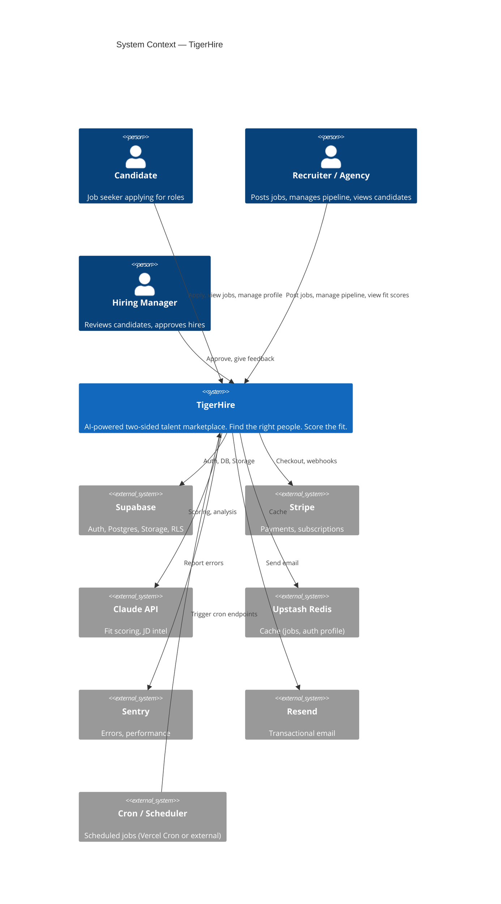
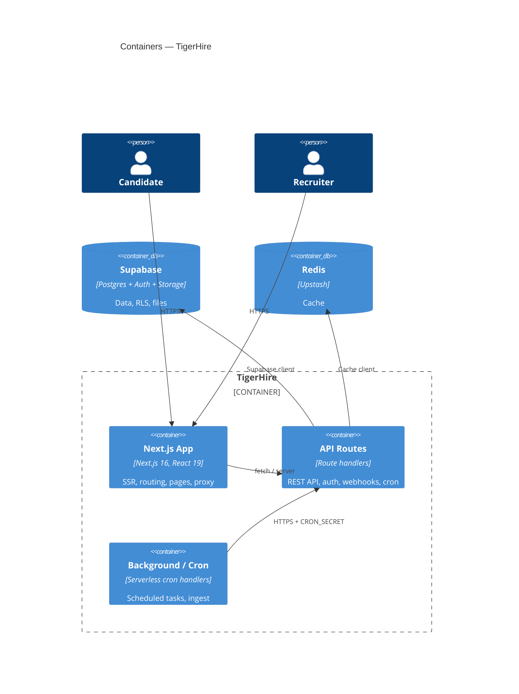
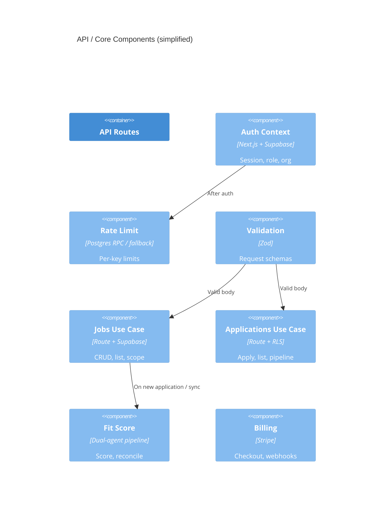

# TigerHire — C4 Architecture Model

C4: **Context → Container → Component → Code**. This document covers Level 1–3; Level 4 (code) is in the codebase and ADRs.

---

## Level 1: System Context

**TigerHire** is the system. External users and systems interact with it.

---

## Level 2: Containers

Containers are major deployable/runnable parts of the system. TigerHire is a single Next.js app; we show logical containers (frontend, API, background).

**Containers summary:**

| Container         | Tech                              | Responsibility                                                    |
| ----------------- | --------------------------------- | ----------------------------------------------------------------- |
| Next.js App       | Next 16, React 19, Tailwind       | Pages, SSR, middleware/proxy, static assets, HMR                  |
| API Routes        | Next Route Handlers               | REST API, auth context, rate limit, Supabase/Stripe/Claude/Resend |
| Background / Cron | Same process, cron-secured routes | Signals ingest, cleanup, scheduled scoring, etc.                  |
| Supabase          | Postgres, GoTrue, Storage         | Data, RLS, auth, files                                            |
| Redis             | Upstash                           | L2 cache (jobs, auth profile)                                     |

---

## Level 3: Components (Key Areas)

Components are notable parts inside the API and app. Only the most important are listed.

### 3.1 API layer (conceptual)

| Component        | Location                                          | Responsibility                                 |
| ---------------- | ------------------------------------------------- | ---------------------------------------------- |
| Auth context     | `getAuthContext()`, `requireAuth()`, `hasRole()`  | Session, role, organisationId; cached in Redis |
| Rate limit       | `checkRateLimit()`, RPC `check_rate_limit_atomic` | Per-key limits; fail closed on errors          |
| Validation       | Zod schemas at route boundaries                   | Body/query validation; 400/422 on invalid      |
| Error reporting  | `reportError()`, Sentry                           | Structured logs; no bare catch                 |
| Supabase clients | Anon, service role, admin                         | RLS vs admin; see ADMIN_CLIENT_AUDIT.md        |

### 3.2 Domain / use cases (conceptual)

| Component    | Location                      | Responsibility                                               |
| ------------ | ----------------------------- | ------------------------------------------------------------ |
| Applications | API + RLS                     | Create/list/update applications; org-scoped                  |
| Jobs         | API + RLS                     | CRUD jobs; hiring manager, agency, client                    |
| Fit score    | `src/lib/fitscore/`           | Three-stage (Role Intel, Candidate Intel, Match), provenance |
| Candidates   | API + storage policies        | List (accessible IDs), resumes, tenant-scoped                |
| Billing      | Stripe webhooks, checkout API | Checkout, subscription, idempotency                          |

### 3.3 Component diagram (simplified)

---

## Level 4: Code

- **Domain / lib:** `src/lib/` — fitscore (three-stage: stage1 role intel, stage2 candidate intel, stage3 match; Supabase adapter for cache and scores), redis, api-helpers, config, services (Apify, extract-document-text).
- **API:** `src/app/api/**` — route handlers by feature (auth, jobs, applications, agency, cron, etc.).
- **UI:** `src/app/(dashboard)/`, `(public)/` — pages and components; dashboard by role (recruit, agency, etc.).
- **Config / infra:** `next.config.ts`, `src/proxy.ts`, `instrumentation.ts`, `supabase/schema/`, migrations.

For detailed code-level decisions, see ADRs: `docs/adr/`, `docs/ADR-001-supabase-and-next.md`, `docs/ADR-002-multi-tenancy.md`, `docs/ADR-004-atomic-rate-limiting.md`, etc.

---

## References

- [ARCHITECTURE-SECURITY-PERF.md](./ARCHITECTURE-SECURITY-PERF.md)
- [ADR-001-supabase-and-next.md](./ADR-001-supabase-and-next.md)
- [ADMIN_CLIENT_AUDIT.md](./ADMIN_CLIENT_AUDIT.md)
- [REDIS_ARCHITECTURE.md](./REDIS_ARCHITECTURE.md)
