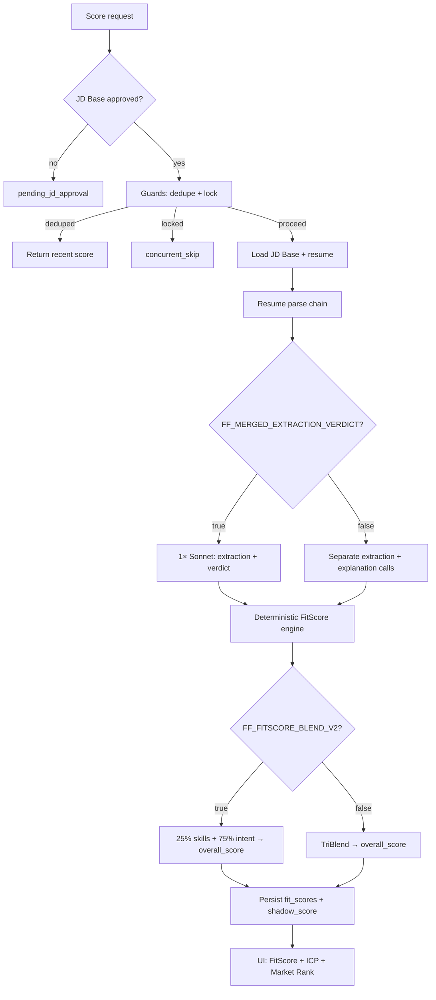

# FitScore scoring architecture

**Audience:** Engineers and operators new to TigerHire.  
**Last updated:** May 2026 (May 18–19 sprint).  
**Code entrypoints:** `FitScoreService.computeSingle` → `runHybridFitScorePipeline` (`src/lib/fitscore/hybrid/pipeline.ts`).

This document describes **how scoring works today** — from resume bytes to the numbers recruiters see — not a changelog.

---

## 1. End-to-end flow



### 1.1 Who can trigger a score

All product paths converge on **`FitScoreService.computeSingle`** with a **`source`** tag (`upload` | `api` | `rescore` | `script` | `investigation`). That source is written to **`platform_cost_events.metadata`** and dedupe/lock observability events.

Typical entrypoints:

| Source          | Examples                                                  |
| --------------- | --------------------------------------------------------- |
| `upload`        | Agency bulk/single upload, public apply after CV save     |
| `api`           | Recruiter “Score”, Inngest `fit-score-single`, batch cron |
| `rescore`       | Admin/rescore routes, calibration scripts                 |
| `script`        | One-off ops scripts                                       |
| `investigation` | A/B and diagnostic harnesses                              |

See also: `docs/principles/scoring-entrypoints-current.md`.

### 1.2 Preconditions

1. **Approved JD Base** for the job (`job_jd_bases` with `approval_status = approved`). Otherwise scoring stops at `pending_jd_approval`.
2. **Candidate resume text** (or PDF buffer for parse chain). Scoring does not block the ingest path; parse failures may yield thin text and lower confidence.

### 1.3 Guards (before any model call)

| Guard               | Mechanism                                                                                                                                                           | Bypass                              |
| ------------------- | ------------------------------------------------------------------------------------------------------------------------------------------------------------------- | ----------------------------------- |
| **Dedupe**          | If a non-superseded `fit_scores` row exists for `(job_id, candidate_id)` with `scoring_status = scored` within **4 hours**, return that row.                        | `force: true` on `computeSingle`    |
| **Concurrent lock** | Postgres RPC `try_acquire_fit_score_scoring_lock` on table `fit_score_scoring_locks`. Second worker gets `concurrent_skip`. Stale locks expire after **2 minutes**. | Same as dedupe for forced rescoring |

Implementation: `src/lib/fitscore/scoring-guard.ts`, migration `20260518180000_fit_score_scoring_locks.sql`.

Dedupe and lock skips emit **`fitscore_dedupe_skip`** / **`fitscore_concurrent_skip`** rows via `scoring-observability.ts` (also rolled into daily metrics).

---

## 2. Resume text: three-tier parse chain

Before hybrid extraction, plain text is resolved by **`runResumeParseChain`** (`src/lib/fitscore/resume-parse-chain.ts`).

| Tier  | Method                                                    | Model / cost | When it runs                                                                                                           |
| ----- | --------------------------------------------------------- | ------------ | ---------------------------------------------------------------------------------------------------------------------- |
| **1** | `pdfjs` (PDF) / **mammoth** (DOCX) / stored `cv_raw_text` | Free         | Always first; **sufficient if ≥ `RESUME_PARSE_MIN_CHARS`** (default **2000**). Legacy `.doc` skips tier 1 → tiers 2–3. |
| **2** | Haiku text enrichment                                     | Cheap        | Tier-1 below threshold and `FF_CV_PARSER_HAIKU_ENABLED` ≠ `false` (default **on**)                                     |
| **3** | Sonnet vision on PDF                                      | Expensive    | Tier-2 still below threshold, PDF bytes present, and `FF_VISION_FALLBACK_ENABLED` ≠ `false`                            |

**Production cost posture (May 2026):** set **`FF_VISION_FALLBACK_ENABLED=false`** so tier 3 is off unless you explicitly need vision. Tier 1 at 2000 chars avoids most vision calls when PDF text extraction is good.

Each tier logs **`resume_processing_tier`** for observability.

---

## 3. Hybrid scoring pipeline (v2)

**Active path:** `scoring_version >= 2` only in product code. Legacy three-stage scoring is removed from product flows; historical rows may still exist with `superseded_at` set.

### 3.1 Models

| Step                                | Default model                    | Override env                        |
| ----------------------------------- | -------------------------------- | ----------------------------------- |
| Merged extraction + verdict         | **Sonnet** (`claude-sonnet-4-6`) | `FITSCORE_HYBRID_MODEL`             |
| Split extraction (if merged off)    | Sonnet                           | `FITSCORE_HYBRID_MODEL`             |
| Verdict explanation (if merged off) | Sonnet                           | `FITSCORE_HYBRID_EXPLANATION_MODEL` |
| Parse chain tier 2                  | Haiku                            | `FITSCORE_HYBRID_HAIKU_MODEL`       |
| Parse chain tier 3                  | Sonnet                           | (vision-fallback path)              |

Central catalog: `src/lib/config/models.ts`.

**May 2026 change:** merged extraction+verdict uses **Sonnet**, not Haiku — one call carries structured extraction, narrative verdict, and evidence quotes when **`FF_MERGED_EXTRACTION_VERDICT=true`**.

### 3.2 Merged vs split calls

| Mode       | Flag                                | API calls per score (typical)            |
| ---------- | ----------------------------------- | ---------------------------------------- |
| **Merged** | `FF_MERGED_EXTRACTION_VERDICT=true` | **1** Sonnet (extraction + verdict JSON) |
| **Split**  | unset / `false`                     | 2+ Sonnet (extraction, then explanation) |

Retries on merged JSON parse failures: **`MERGED_EXTRACTION_MAX_ATTEMPTS=1`** (hard cap in `src/lib/fitscore/hybrid/constants.ts`).

### 3.3 Prompt caching

Static hybrid prompt content is assembled into **one system prefix** with a single Anthropic **`cache_control: { type: "ephemeral" }`** breakpoint (`extraction-and-verdict.ts`, `extraction.ts`, `explanation.ts`).

- Previously, two sub-minimum cache blocks failed to cache; they are **merged** so cache reads register on follow-up scores for the same JD Base.
- Token fields persist on **`platform_cost_events.metadata`**: `cache_creation_input_tokens`, `cache_read_input_tokens`.
- Validate with `FITSCORE_SCORING_DIAGNOSTIC=true` and `scripts/validate-fitscore-prompt-cache.ts`.

**Observed (May 2026 QA cohort):** ~**72%** cache read rate on Sonnet scoring calls after merge — see `docs/ops/HYBRID_V2_CLAIM_ALIGNMENT.md`.

### 3.4 Deterministic engine + fallback

After LLM extraction:

1. **Deterministic scorer** maps rubric dimensions, certifications, red/green flags, and penalties to a **`ScoreBreakdown`** (`pipeline.ts`).
2. If merged Sonnet returns invalid JSON and **`FF_DETERMINISTIC_FALLBACK_ENABLED`** is on (default), **`buildDeterministicFallbackScore`** produces a score from regex/signals without a second LLM call (`deterministic-fallback.ts`).

### 3.5 Extraction signals log

Every scored profile appends a structured **`signals_log`** entry under `fit_scores.v2_score_breakdown` (`extraction-signals-log.ts`) — tier used, char counts, model path, cache tokens, fallback reason. Used for ops debugging and daily metrics aggregation.

---

## 4. Score formula and what recruiters see

### 4.1 Three numbers on cards

| UI label        | Meaning                                | Storage                                |
| --------------- | -------------------------------------- | -------------------------------------- |
| **FitScore**    | Primary hiring score (see blend below) | `fit_scores.overall_score`             |
| **ICP Match**   | Ideal-candidate profile alignment %    | `v2_score_breakdown` / display helpers |
| **Market Rank** | Market positioning %                   | `v2_score_breakdown`                   |

Components: `FitScoreTripleMetrics.tsx`, `fit-score-display-helpers.ts`.

### 4.2 Primary blend (production default when enabled)

When **`FF_FITSCORE_BLEND_V2=true`** (and public flag for UI):

```
FitScore = 0.25 × skills_signal + 0.75 × intent_match
```

- **skills_signal:** dimension-weighted extraction + certification bonus (capped).
- **intent_match:** narrative alignment (impact/green bonuses minus red penalties on top of dimensions).

Implementation: `src/lib/fitscore/hybrid/blend-v2.ts`.

### 4.3 Shadow score (comparison only)

**TriBlend** (40% skills / 30% intent / 30% market-style composite) is still computed and stored in **`shadow_score`** on the same row for A/B comparison against the new 25/75 primary. It is **not** the headline number when blend v2 is on.

---

## 5. JD Base approval (recruiter setup)

Scoring rubric and ideal profile come from an **approved JD Base**, not raw job text alone.

**UX:** Three-screen wizard (ICP → Rubric → Review) for recruit, agency, and company job flows.

Full product/UX spec: **`docs/JD_BASE_APPROVAL_FLOW.md`**.

Summary:

1. **ICP screen** — role summary, years, skills, **traits**, **background preferences** (saved on `ideal_candidate_profile` JSON).
2. **Rubric screen** — dimension sliders summing to **100%** (`scoring_weights`).
3. **Review screen** — JD text vs scoring config side-by-side; **mismatch detection** warns when rubric/ICP diverges from JD (years, “preferred” skills weighted too high, template vs JD conflicts).

Templates **suggest** weights and ICP; **JD text drives** mismatch warnings. Approval writes one `job_jd_bases` row (no schema split per screen).

---

## 6. Cost attribution and monitoring

### 6.1 Platform cost ledger

Every Anthropic call on the scoring path should flow through **`callClaude` / `callClaudeWithUserContent`** → **`recordAnthropicCostEvent`** (`src/lib/costs/ledger.ts`).

Rows include:

- `job_id`, `candidate_id` when known
- `metadata.source` — scoring entrypoint
- `metadata.model`, token counts, **cache\_\*\_tokens**
- Labels such as `vision-fallback-resume`, hybrid extraction, merged path

Brief: `docs/briefs/platform-cost-ledger-hardening.md`.

### 6.2 Daily metrics cron

**Schedule:** `30 0 * * *` UTC → `GET /api/cron/fitscore-daily-metrics` (`vercel.json`).

**Table:** `scoring_daily_metrics` — per UTC day aggregates: dedupe skips, lock skips, tier mix, Sonnet/Haiku token totals, cache read rate, deterministic fallback count, etc.

**Code:** `src/lib/fitscore/scoring-daily-metrics.ts`.

Super-admin dashboards and alerts should treat missing cron runs as an ops gap.

---

## 7. Feature flags and environment variables

Canonical list with defaults: **`.env.example`** (FitScore section).

| Variable                            | Shipped intent (May 2026)                              |
| ----------------------------------- | ------------------------------------------------------ |
| `FITSCORE_HYBRID_MODEL`             | Sonnet (`claude-sonnet-4-6`)                           |
| `FF_MERGED_EXTRACTION_VERDICT`      | `true` — one call per score                            |
| `FF_VISION_FALLBACK_ENABLED`        | `false` in prod (opt-out in code: default on if unset) |
| `FF_CV_PARSER_HAIKU_ENABLED`        | `true`                                                 |
| `FF_DETERMINISTIC_FALLBACK_ENABLED` | `true`                                                 |
| `MERGED_EXTRACTION_MAX_ATTEMPTS`    | `1`                                                    |
| `RESUME_PARSE_MIN_CHARS`            | `2000`                                                 |
| `FF_FITSCORE_BLEND_V2`              | `true`                                                 |
| `NEXT_PUBLIC_FF_FITSCORE_BLEND_V2`  | `true` (UI three-score display)                        |
| `FITSCORE_SCORING_DIAGNOSTIC`       | `true` in staging; optional in prod                    |

---

## 8. Rough cost per profile (order of magnitude)

With **merged Sonnet + caching + vision off + tier-1 parse**:

- Expect **~$0.05–0.10 USD** per full score pass (ledger + Anthropic Console), down from higher spend when every PDF hit vision and split calls duplicated prompts.

Actuals depend on JD length, cache warmth, and whether tier-2 Haiku runs. Use **`platform_cost_events`** filtered by `job_id`/`candidate_id` for ground truth.

---

## 9. Related documents

| Doc                                              | Topic                                 |
| ------------------------------------------------ | ------------------------------------- |
| `docs/FITSCORE_COST_CONTROLS_BRIEF.md`           | Dedupe, locks, parse chain, fallbacks |
| `docs/JD_BASE_APPROVAL_FLOW.md`                  | Three-screen JD Base wizard           |
| `docs/SCORING_HARDENING_STATUS.md`               | Hardening PRD items vs shipped state  |
| `docs/ops/HYBRID_V2_CLAIM_ALIGNMENT.md`          | Acceptance gates and metrics          |
| `docs/briefs/platform-cost-ledger-hardening.md`  | Ledger reconciliation                 |
| `docs/principles/scoring-entrypoints-current.md` | API/route map                         |
