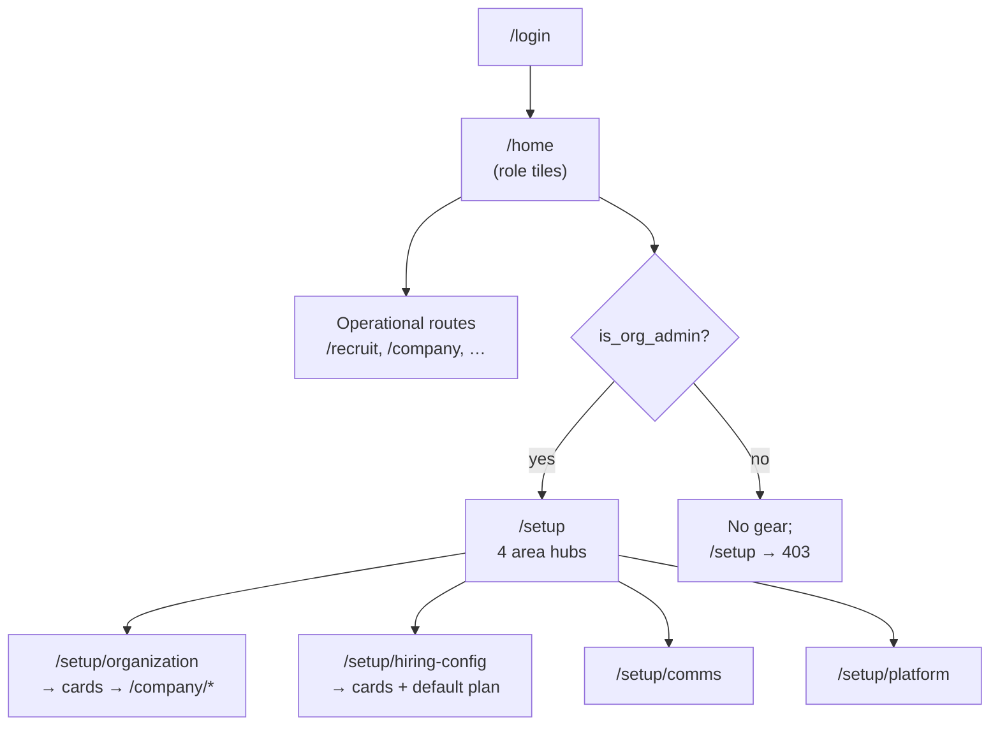

# Home & Setup — End-to-end testing guide

This document explains how **Home**, **Setup mode**, and **org configuration** work today, and gives step-by-step checks you can run manually (or turn into Playwright cases).

---

## What you are testing

TigerHire separates **operational work** (jobs, pipeline, candidates) from **organisation configuration** (settings, billing, workflows).

| Surface             | URL                                                              | Who can access                                                                                   |
| ------------------- | ---------------------------------------------------------------- | ------------------------------------------------------------------------------------------------ |
| **Home**            | `/home`                                                          | All customer-shell roles (leadership, recruiter, hiring manager, interviewer, finance, employee) |
| **Setup hub**       | `/setup` and `/setup/*`                                          | Users with `profiles.is_org_admin = true` only                                                   |
| **Legacy settings** | `/company/settings/*`, `/company/team`, `/company/billing`, etc. | Same rules as before; many cards in Setup link here                                              |

**Roles vs flags (do not confuse them):**

- **`leadership`** — Replaces the old `company_admin` role. Controls operational “company hub” access (jobs, approvals, etc.).
- **`is_org_admin`** — Separate boolean on `profiles`. Controls the **gear icon**, `/setup/**`, and org-wide config paths (team, billing, most `/company/settings` except hiring-config exceptions below).
- **`is_platform_admin`** — TigerHire internal `/admin/*` only. Unrelated to org setup.

After the Brief 1 migration, every user with `role = leadership` is backfilled with `is_org_admin = true`.

---

## Prerequisites (local)

1. **Environment**
   - Copy `.env.example` → `.env.local`.
   - Set Supabase URL and keys so login works.
   - For demo login: set `SEED_DEMO_PASSWORD` (see login page hint).

2. **Database**
   - Apply migrations (includes `leadership` role and `is_org_admin` column).
   - Run dev server: `npm run dev` → http://localhost:3000

3. **Seed demo users (dev only)**
   - Open `/login`.
   - Click **Setup demo users** once (or `POST /api/auth/seed-demo-users` in development).
   - Sign in with a one-click test account (password = `SEED_DEMO_PASSWORD`, often `demo123` in dev).

4. **Optional: plan document / default recruitment plan**
   - In `.env.local`:
     ```bash
     FF_PLAN_DOCUMENT=true
     NEXT_PUBLIC_FF_PLAN_DOCUMENT=true
     ```
   - Restart the dev server (public flags are inlined at build time).

5. **Optional: richer Finstack data**
   - After seeding users, run Finstack seed per `POST /api/seed/finstack` (see route comment: run after seed-demo-users).

---

## Test accounts

### Login page (development)

One-click accounts on `/login` (after **Setup demo users**):

| Label                | Email                                                   | Role             | Lands on     |
| -------------------- | ------------------------------------------------------- | ---------------- | ------------ |
| Super Admin          | `sam@tigerhire.io`                                      | `super_admin`    | `/admin`     |
| Company Admin        | `nidhi.gupta@finstack.in`                               | `leadership`     | `/home`      |
| Recruiter            | `rajiv.menon@finstack.in`                               | `recruiter`      | `/home`      |
| Hiring Manager       | `kavita.rao@finstack.in`                                | `hiring_manager` | `/home`      |
| Employee             | `meera.nair@finstack.in`                                | `employee`       | `/employee`  |
| Agency               | `fatima.sheikh@talentbridge.co`                         | `agency`         | `/agency`    |
| Candidate Pro / Free | `priya.sharma@gmail.com`, `siddharth.patil@outlook.com` | candidate        | `/candidate` |
| Interviewer          | `lakshmi.interviewer@finstack.in`                       | interviewer      | `/home`      |
| Finance              | `lakshmi.finance@finstack.in`                           | finance          | `/home`      |

**Org admin for Setup:** Nidhi (`leadership`) should have `is_org_admin = true` after migration backfill. Rajiv (`recruiter`) does **not** unless you set it manually (see below).

### Alternate Razorpay seed (`scripts/seed-demo-users.mjs`)

| Email                    | Role         | Password    |
| ------------------------ | ------------ | ----------- |
| `hiring@razorpay.com`    | `leadership` | `Demo@1234` |
| `recruiter@razorpay.com` | `recruiter`  | `Demo@1234` |

---

## Forcing `is_org_admin` (negative / cross-role tests)

Use Supabase SQL (or Table Editor) on `profiles`:

```sql
-- Recruiter who can open Setup (unusual but supported)
UPDATE profiles SET is_org_admin = true
WHERE id = (SELECT id FROM auth.users WHERE email = 'rajiv.menon@finstack.in');

-- Leadership exec who must NOT see Setup gear
UPDATE profiles SET is_org_admin = false
WHERE id = (SELECT id FROM auth.users WHERE email = 'nidhi.gupta@finstack.in');
```

Sign out and sign back in after changing the flag (profile is cached briefly).

---

## Architecture at a glance



**Sidebar:** Operational nav no longer lists `/setup` or `/company/settings/*`. Configuration is intended to be reached via the **gear** or direct URLs.

---

## Test suite A — Login & Home

### A1 — Post-login landing

| Step | Action                                 | Expected                                |
| ---- | -------------------------------------- | --------------------------------------- |
| 1    | Sign in as **Nidhi** (leadership)      | Redirect to **`/home`**, not `/company` |
| 2    | Sign in as **Rajiv** (recruiter)       | **`/home`**                             |
| 3    | Sign in as **Kavita** (hiring manager) | **`/home`**                             |
| 4    | Sign in as **Sam** (super admin)       | **`/admin`**                            |

### A2 — Home tiles (role-specific)

On `/home`, confirm tiles match the role (empty states are OK if there is no data):

| Role                             | You should see (examples)                                        |
| -------------------------------- | ---------------------------------------------------------------- |
| Leadership                       | Open roles, pipeline (7d), offers (30d), referral leaders        |
| Recruiter                        | Applications today, pipeline rows, open jobs, stale pipeline     |
| Hiring manager                   | Owned jobs, pipeline awaiting, hiring requests                   |
| Finance / Interviewer / Employee | Their respective tile sets (see `src/lib/home/tile-registry.ts`) |

**Note:** If `NEXT_PUBLIC_FF_PLAN_DOCUMENT=true`, leadership/recruiter/HM may also see plan-document tiles (hiring velocity, pipeline health, etc.).

### A3 — Home does not depend on org admin (today)

| Step | Action                                     | Expected                                       |
| ---- | ------------------------------------------ | ---------------------------------------------- |
| 1    | Set Nidhi `is_org_admin = false`, re-login | Home tiles **unchanged**; gear hidden (Test B) |

---

## Test suite B — Setup access & gear

### B1 — Gear visibility

| User               | `is_org_admin`    | Expected                                      |
| ------------------ | ----------------- | --------------------------------------------- |
| Nidhi (leadership) | `true` (default)  | Amber **gear** in top bar → links to `/setup` |
| Rajiv (recruiter)  | `false` (default) | **No** gear                                   |
| Rajiv              | `true` (SQL)      | Gear visible                                  |

### B2 — Setup route gate (403)

While signed in as Rajiv with `is_org_admin = false`:

| URL                    | Expected                       |
| ---------------------- | ------------------------------ |
| `/setup`               | **403 Forbidden** (middleware) |
| `/setup/hiring-config` | **403**                        |

While signed in as Nidhi with `is_org_admin = true`: same URLs return **200** and render Setup UI.

### B3 — Setup hub navigation

As org admin (Nidhi):

| Step | Action                        | Expected                                                       |
| ---- | ----------------------------- | -------------------------------------------------------------- |
| 1    | Click gear                    | `/setup` landing with four cards                               |
| 2    | Open **Organisation**         | `/setup/organization` — cards for profile, team, billing, etc. |
| 3    | Open **Hiring configuration** | `/setup/hiring-config`                                         |
| 4    | Open **Comms & trust**        | `/setup/comms`                                                 |
| 5    | Open **Platform**             | `/setup/platform`                                              |
| 6    | Click **← Back to dashboard** | Returns to **`/home`**                                         |

Visual cue: Setup layout uses a darker background band and dashed amber styling on the gear.

---

## Test suite C — Organisation & org-only settings

As **Nidhi** (`is_org_admin = true`), from `/setup/organization`:

| Card                 | Opens                           | Smoke check                          |
| -------------------- | ------------------------------- | ------------------------------------ |
| Org profile          | `/company/settings`             | Page loads; can view/edit org fields |
| Team & roles         | `/company/team`                 | Member list loads                    |
| Billing & plan       | `/company/billing`              | Billing UI loads                     |
| Permissions          | `/company/settings/permissions` | Settings form loads                  |
| Pending resignations | `/company/pending-resignations` | Page loads                           |
| Referral program     | `/company/referrals`            | Page loads                           |

As **Rajiv** with `is_org_admin = false`:

| URL                 | Expected                |
| ------------------- | ----------------------- |
| `/company/settings` | Redirect to **`/home`** |
| `/company/billing`  | Redirect to **`/home`** |
| `/company/team`     | Redirect to **`/home`** |

As **Rajiv** with `is_org_admin = false` — **hiring-config exception** (Brief 3 Phase 2):

| URL                                 | Expected                                              |
| ----------------------------------- | ----------------------------------------------------- |
| `/company/settings/pipeline`        | **Allowed** (recruiter + leadership)                  |
| `/company/settings/screening`       | **Allowed**                                           |
| Other hiring-config paths in policy | **Allowed** (see list in `dashboard-route-policy.ts`) |

---

## Test suite D — Hiring configuration

From `/setup/hiring-config` as org admin:

| Card                           | Target URL                                        |
| ------------------------------ | ------------------------------------------------- |
| Default recruitment plan       | `/setup/hiring-config/default-recruitment-plan`   |
| Pipeline stages                | `/company/settings/pipeline`                      |
| Screening defaults             | `/company/settings/screening`                     |
| Offer letter templates         | `/company/settings/offer-letter-templates`        |
| Offer letter flow (comp bands) | `/company/settings/compensation-bands`            |
| Offer approval workflow        | `/company/settings/offer-approval-workflow`       |
| Requisition templates          | `/company/settings/requisition-templates`         |
| Requisition approval           | `/company/settings/requisition-approval-workflow` |
| Requisition delegations        | `/company/settings/requisition-delegations`       |

### D1 — Default recruitment plan (feature-flagged)

Path: **Setup → Hiring configuration → Default recruitment plan**

| Condition                                      | Expected                                                                   |
| ---------------------------------------------- | -------------------------------------------------------------------------- |
| `NEXT_PUBLIC_FF_PLAN_DOCUMENT` not `true`      | Message: enable plan document mode                                         |
| Flag `true`, org admin                         | Loads stages from `GET /api/org/recruitment-plan-defaults`; **Save** works |
| Flag `true`, recruiter, `is_org_admin = false` | Read-only banner; save disabled                                            |
| Flag `true`, recruiter, `is_org_admin = true`  | Can edit and save                                                          |

**API check (optional):** `PUT /api/org/recruitment-plan-defaults` without org admin → **403**.

### D2 — Downstream effect (if you have a test job)

1. Save default stages in Setup.
2. Create or open a job that uses org defaults.
3. Confirm new jobs inherit default plan stages (product-specific; verify on a job’s recruitment plan UI).

---

## Test suite E — Comms & platform

From `/setup/comms` and `/setup/platform` as org admin, open each card and confirm the legacy page loads:

| Area     | URLs                                                              |
| -------- | ----------------------------------------------------------------- |
| Comms    | `/company/settings/privacy`, `.../audit`, `.../outbound-webhooks` |
| Platform | `/company/settings/integrations`, `.../job-boards`                |

---

## Test suite F — Sidebar & navigation hygiene

Signed in as **Nidhi** or **Rajiv**:

| Check                                            | Expected               |
| ------------------------------------------------ | ---------------------- |
| Sidebar contains **Home** (`/home`)              | Yes                    |
| Sidebar contains **Setup** or **Settings** links | **No**                 |
| Operational items (Jobs, Pipeline, etc.)         | Still present per role |

---

## Test suite G — Regression matrix (quick)

Run this checklist before release:

- [ ] All customer roles land on correct post-login path (`/home` or role shell).
- [ ] Home shows ≥1 tile per role; no infinite loading spinner.
- [ ] `is_org_admin = true` → gear + `/setup` works.
- [ ] `is_org_admin = false` → no gear; `/setup` → 403.
- [ ] Non–org-admin blocked from `/company/settings`, `/company/billing`, `/company/team`.
- [ ] Recruiter/leadership **can** open hiring-config settings URLs without org admin.
- [ ] Setup area hubs link through to working legacy pages (no 404).
- [ ] Default recruitment plan save works when plan-document flag is on (org admin only).

---

## Automated tests (reference)

| Area                          | Location                                           |
| ----------------------------- | -------------------------------------------------- |
| Role × `is_org_admin` matrix  | `tests/unit/role-org-admin-matrix.test.ts`         |
| Hiring-config path exceptions | `tests/unit/hiring-config-settings-access.test.ts` |
| Home tile registry            | `tests/unit/home-tile-registry.test.ts`            |
| E2E login helper              | `e2e/helpers/login.ts`                             |

Run unit tests: `npm test -- tests/unit/role-org-admin-matrix.test.ts`

Run E2E: `npm run test:e2e` (requires Playwright + seeded DB).

### Pilot exhaustive suite (automated)

Maps to the 5-person pilot test plan. Uses **one-click login** on `/login` (same as manual testing).

```bash
cp .env.pilot-e2e.example .env.pilot-e2e.local   # add PILOT_PHONE_* when ready
npm run pilot:pretest                              # accounts, agency link, lifecycle seed, phones
npm run pilot:seed                                 # lifecycle gate + offer fixtures only
npm run dev                                        # in another terminal
npm run test:e2e:pilot
npm run pilot:db-check                             # optional Sam-style DB checks
```

Specs live under `e2e/pilot/`:

| File                     | Acts covered                                                                 |
| ------------------------ | ---------------------------------------------------------------------------- |
| `act-01-login-roles`     | 1 — login, gear, sidebar                                                     |
| `act-02-setup-rbac`      | 2 — setup access                                                             |
| `act-03-requisition-job` | 3 — hiring request → approve → plan (skipped if `PILOT_JOB_ID` set)          |
| `act-04-intake`          | 4 — apply, agency dashboard, employee referral, WhatsApp webhook             |
| `act-04-agency-bulk`     | 4 — agency bulk upload (3 CVs) when TalentBridge→Finstack client link exists |
| `act-lifecycle-serial`   | 3–8 — one job: gate → Tasks approve → stage move → plan → offer (serial)     |
| `act-05-scoring`         | 5 — FitScore / verdict on pipeline                                           |
| `act-06-pipeline`        | 6 — pipeline move, 409 gate, Tasks Decide → Approve                          |
| `act-07-scheduling`      | 7, 11 — create slots, calendar, interviewer queue                            |
| `act-08-offers`          | 8 — draft offer link, finance inbox                                          |
| `act-09-tasks`           | 9 — tasks inbox, Decide → Approve when pending                               |
| `act-10-plan`            | 10 — plan readiness                                                          |
| `act-12-edge-cases`      | 12 — URL RBAC                                                                |

WhatsApp scenes use webhook simulation when `WHATSAPP_META_APP_SECRET` is set. Full lifecycle uses the QA job (`861e8c58-…`) unless ACT 3 creates a new job. `pilot:pretest` links **TalentBridge → Finstack** for agency bulk upload. Helpers: `e2e/helpers/pilot-tasks.ts` (list/approve Decide tasks).

---

## UAT guide — what to test manually (and what people skip)

Use this for **preview / production UAT** with real phones and real judgement.  
`npm run test:e2e:pilot` covers **navigation, RBAC, and happy-path UI smoke** — it does **not** replace hands-on WhatsApp, approval judgement, or “does this feel right for my role?”.

### How to run UAT efficiently

| Step | Who           | Action                                                                                                      |
| ---- | ------------- | ----------------------------------------------------------------------------------------------------------- |
| 1    | Dev / Santosh | `npm run pilot:pretest`, env flags on preview, one canonical job (“Senior Backend Engineer — Bangalore”)    |
| 2    | Anyone        | Run `npm run test:e2e:pilot` on preview URL — if green, **don’t re-test** login tiles, setup 403, URL hacks |
| 3    | All 5 testers | Work through **Must test manually** below on **one shared job** through the lifecycle                       |
| 4    | Sam           | DB / `whatsapp_message_log` checks when WhatsApp behaviour is disputed                                      |
| 5    | Santosh       | Go / no-go from sign-off checklist at the bottom                                                            |

**Accounts:** one-click buttons on `/login` (after **Setup demo users** on dev/preview). Interviewer + finance: `lakshmi.interviewer@finstack.in`, `lakshmi.finance@finstack.in` (password `demo123` or `SEED_DEMO_PASSWORD`). Add **phone numbers** to Rajiv, Meera, interviewer profiles before referral tests.

---

### Already covered by automation — light touch only

Confirm these only if something feels broken; do not spend a full UAT pass on them.

- Post-login landing per role (`/admin`, `/home`, `/employee`, `/agency`)
- Org admin **gear** vs recruiter **no gear**
- `/setup` and `/company/billing` blocked for non–org-admin
- Recruiter can open **pipeline / screening** settings without org admin
- `/tasks` inbox loads, filters, **Decide → Approve** when pending (recruiter / HM / finance in lifecycle spec)
- Finance → `/company/finance`; interviewer → `/company/interviews` (not `/tasks`)
- Plan page: readiness strip, stage automation chip, **Create slots** dialog opens
- Public apply page loads; agency dashboard loads; **agency bulk upload** (3 CVs) when client link exists
- Pipeline **409** when moving past a gated stage without approval; serial lifecycle advances after approvals

---

### Must test manually — what UAT usually skips

These are the highest-value human checks. **Stop and screenshot** on first failure; don’t plough through the rest.

#### 1. WhatsApp on a real phone (not optional)

Automation simulates webhooks only. UAT must use **real devices** and Meta-delivered templates.

| #   | Who          | Do                                         | Pass criteria                                                                 |
| --- | ------------ | ------------------------------------------ | ----------------------------------------------------------------------------- |
| 1.1 | Shatabdi     | Refer Snigdha (YES path) for the pilot job | Snigdha gets **consent template** (not plain text) → YES → CV → ack           |
| 1.2 | Shatabdi     | Refer Santosh second number (NO path)      | Consent → NO → bot **stops**; further messages ignored                        |
| 1.3 | Lakshmipathi | Employee **Refer Someone** on dashboard    | Referred person gets consent on WhatsApp; **My Referrals** shows pending      |
| 1.4 | Lakshmipathi | Public careers **Apply** + PDF             | Application in pipeline; FitScore runs (~60s)                                 |
| 1.5 | Snigdha      | After stage moves                          | Receives `th_shortlisted`, screening, slots, or offer templates as configured |
| 1.6 | Sam          | `whatsapp_message_log`                     | Template names match stage (not ad-hoc text for gated templates)              |

**Often skipped:** consent is plain text; NO path still progresses; employee referral never triggers; wrong template after stage move.

#### 2. Full lifecycle on one job (end-to-end story)

Run **one candidate** (Snigdha) from intake → offer on the **same** job. Automation does not chain this.

| Phase       | Who                               | Do                                              | Pass criteria                                        |
| ----------- | --------------------------------- | ----------------------------------------------- | ---------------------------------------------------- |
| Requisition | Snigdha → Santosh/Nidhi           | Create hiring request → approve                 | Job exists; Plan **Launch** shows req approved       |
| JD + IP     | Shatabdi → Snigdha                | Edit JD → generate Ideal Profile → HM approve   | Readiness: JD ✅ IP ✅; scoring enabled              |
| Pipeline    | Shatabdi                          | Move Snigdha through stages                     | Plan activity + automation events update             |
| Screening   | Shatabdi → Snigdha                | Move to Recruiter Screen / phone screen         | WhatsApp screening Qs; answers on **candidate card** |
| Shortlist   | Shatabdi → Snigdha                | Shortlist → HM approve in **/tasks**            | Gate clears; move past HM-gated stage works          |
| Interview   | Shatabdi → Snigdha → Lakshmipathi | Slot picker → book → feedback                   | Interviewer sees interview; feedback on Plan         |
| Offer       | Shatabdi → Lakshmipathi → Snigdha | Draft → finance approve → HM approve → **send** | Snigdha gets offer on WhatsApp; offer row correct    |

**Often skipped:** only testing login; stopping at pipeline without offer; not doing HM + finance approvals; never clicking **Send offer**.

#### 3. Role boundaries (negative testing)

People test “their” role only. Spend **10 minutes per role** URL-hacking and checking **wrong** nav items.

| Role              | Try (should fail or scope down)                   | Should see instead         |
| ----------------- | ------------------------------------------------- | -------------------------- |
| HM (Kavita)       | `/company/billing`, `/company/team`, all org jobs | My Jobs / My Pipeline only |
| Employee (Meera)  | `/recruit/pipeline`, `/company/settings`          | Refer & Earn only          |
| Recruiter (Rajiv) | `/setup`, billing                                 | No gear; pipeline/jobs OK  |
| Agency (Fatima)   | `/company/team`, Finstack pipeline                | Agency dashboard only      |
| Interviewer       | `/tasks` expecting recruiter tasks                | Interviews queue only      |
| Finance           | `/recruit/pipeline`                               | Finance inbox only         |

**Often skipped:** HM sees all jobs; employee opens pipeline; recruiter sees billing.

#### 4. Tasks command center (judgement, not just “page loads”)

| #   | Who       | Do                                 | Pass criteria                                                     |
| --- | --------- | ---------------------------------- | ----------------------------------------------------------------- |
| 4.1 | Each role | Open `/tasks`                      | **Only** tasks for that role (see table in exhaustive plan ACT 9) |
| 4.2 | Shatabdi  | Filter by job + phase + **Decide** | Drawer shows correct candidate/score; Approve/Reject works        |
| 4.3 | Everyone  | After acting on all tasks          | **Zero pending** that belong to you (or explain why)              |
| 4.4 | Shatabdi  | Try pipeline move without approval | Clear error pointing to **Tasks**                                 |

**Often skipped:** only opening Tasks once; not filtering by job; not completing Decide flows; not verifying 409 gate.

#### 5. Plan page as source of truth

| #   | Who      | Do                  | Pass criteria                                                        |
| --- | -------- | ------------------- | -------------------------------------------------------------------- |
| 5.1 | Shatabdi | After lifecycle     | Launch / Pipeline / Hire lifecycles match reality                    |
| 5.2 | Shatabdi | Activity panel      | Human events (names, timestamps) + system events (moves, automation) |
| 5.3 | Shatabdi | Pending tasks count | Matches `/tasks` for that job                                        |
| 5.4 | Shatabdi | Stuck candidates    | Empty or correctly flagged only                                      |

**Often skipped:** never opening Plan after pipeline moves; activity panel not checked.

#### 6. Setup & org config (org admin only)

| #   | Who   | Do                                                 | Pass criteria                                           |
| --- | ----- | -------------------------------------------------- | ------------------------------------------------------- |
| 6.1 | Nidhi | Gear → all Setup areas                             | Organisation, Hiring config, Comms, Platform cards open |
| 6.2 | Nidhi | Default recruitment plan save                      | Saves without error (flags on)                          |
| 6.3 | Rajiv | Same URLs as Nidhi for **pipeline/screening only** | Allowed without gear                                    |

**Often skipped:** only testing Home; never opening Setup; not verifying recruiter exception paths.

#### 7. Scoring & trust (recruiter + HM)

| #   | Who      | Do                           | Pass criteria                                                     |
| --- | -------- | ---------------------------- | ----------------------------------------------------------------- |
| 7.1 | Shatabdi | Open Snigdha’s verdict card  | Score, band, **CV quotes**, referrer badge, ideal match %         |
| 7.2 | Shatabdi | Vouch for referred candidate | Vouch visible; no false circular-vouch block for referrer+voucher |
| 7.3 | Snigdha  | Edit IP → re-approve         | Re-score notification; scores update                              |

**Often skipped:** only checking a number; not reading quotes; not re-score after IP change.

#### 8. Calendar & scheduling

| #   | Who      | Do                               | Pass criteria                    |
| --- | -------- | -------------------------------- | -------------------------------- |
| 8.1 | Shatabdi | Job **Scheduling** → create slot | Slot saved; visible on tab       |
| 8.2 | Shatabdi | `/calendar`                      | Shows interview(s) for pilot job |
| 8.3 | Snigdha  | WhatsApp slot picker             | Can book; confirmation message   |

**Often skipped:** only clicking Create slots once; never booking from candidate phone.

#### 9. Data & environment (before blaming the app)

| Check                                                               | Owner   |
| ------------------------------------------------------------------- | ------- |
| `FF_PLAN_DOCUMENT` + `NEXT_PUBLIC_FF_PLAN_DOCUMENT` on preview/prod | Santosh |
| `FF_PLAN_AUTO_EXECUTE` if testing screening automation              | Santosh |
| `OUTBOUND_NOTIFICATIONS_ENABLED`, `WHATSAPP_MODE` not sandbox       | Santosh |
| `th_screening_invite` approved in Meta (or document skip)           | Santosh |
| Phones on profiles; whatsapp sessions cleared for test numbers      | Santosh |
| Pilot job exists with approved IP and plan stages                   | Santosh |

**Often skipped:** testing with flags off; sandbox WhatsApp; dirty session state from yesterday.

---

### Out of scope for this UAT (do not file as bugs yet)

| Feature                                            | Why                    |
| -------------------------------------------------- | ---------------------- |
| Email approval / feedback notifications            | Not shipped (Brief #4) |
| Candidate web status portal                        | Not built              |
| Full org calendar week grid (create from calendar) | Dev-only / partial     |
| Vernacular WhatsApp                                | Not built              |
| Naukri/LinkedIn import, assessments integration    | Post-pilot             |

---

### Suggested UAT session order (~3 hours, 5 people)

| Block | Time   | Focus                                                                             |
| ----- | ------ | --------------------------------------------------------------------------------- |
| A     | 15 min | Santosh: env + job + phones; everyone: login once (automation already did matrix) |
| B     | 20 min | ACT 2 Setup: Nidhi + Rajiv (gear / no gear)                                       |
| C     | 25 min | ACT 4 intake: all four channels (WhatsApp heavy)                                  |
| D     | 20 min | ACT 3 job setup: requisition → JD → IP                                            |
| E     | 45 min | ACT 5–6: scoring, pipeline, screening, shortlist                                  |
| F     | 30 min | ACT 7–8: interview + offer                                                        |
| G     | 15 min | ACT 9–10: Tasks zero pending + Plan screenshot                                    |
| H     | 10 min | ACT 12: negative URLs per role                                                    |

---

### UAT sign-off (paste in Slack / PR)

```
Pilot UAT — [preview / prod] — [date]
Job: Senior Backend Engineer — Bangalore (id: ___)

Automated pilot E2E: [ ] pass  [ ] fail (link report)
WhatsApp real-device: [ ] pass  [ ] partial  [ ] fail
Lifecycle one candidate through offer: [ ] pass  [ ] fail
Role boundaries spot-check: [ ] pass  [ ] fail
Tasks + Plan match: [ ] pass  [ ] fail

Blockers (stop ship):
-

Non-blockers / follow-ups:
-
```

---

## Known limitations (current build)

1. **Setup manifest vs pages** — `src/features/setup/config/manifest.ts` lists many `/setup/...` paths; only a subset have App Router pages today. Area hubs link to **canonical** `/company/*` URLs, which is the supported path for E2E until Brief 3 fills nested Setup routes.

2. **`SetupShell`** — Sidebar section nav for Setup areas exists in code but is not yet wired into `setup/layout.tsx` (layout still uses a simple back link + content).

3. **Seed script** — `POST /api/auth/seed-demo-users` sets `is_org_admin` for `leadership` role; other roles default false.

4. **Plan document** — Requires env flags; without them, default recruitment plan UI shows an enablement message only.

---

## Troubleshooting

| Symptom                           | Likely cause                               | Fix                                                  |
| --------------------------------- | ------------------------------------------ | ---------------------------------------------------- |
| No test accounts on login         | Demo seed not run                          | Click **Setup demo users**; set `SEED_DEMO_PASSWORD` |
| Gear missing for “admin” user     | `is_org_admin` false                       | SQL update; re-login                                 |
| `/setup` 403 for leadership       | `is_org_admin` false                       | Same                                                 |
| Redirect to `/home` from settings | Not org admin (and not hiring-config path) | Use org admin account or hiring-config URL           |
| Default plan won’t save           | Flag off or read-only user                 | Enable `NEXT_PUBLIC_FF_PLAN_DOCUMENT`; use org admin |
| Stale permissions after SQL       | Auth profile cache                         | Sign out/in; wait ~30s                               |

---

## Related docs

- Product brief: `docs/brief-1-role-model-home-setup-shell.md`
- Setup route manifest: `src/features/setup/config/manifest.ts`
- General UI E2E patterns: `docs/UI_TESTING_GUIDE.md`
