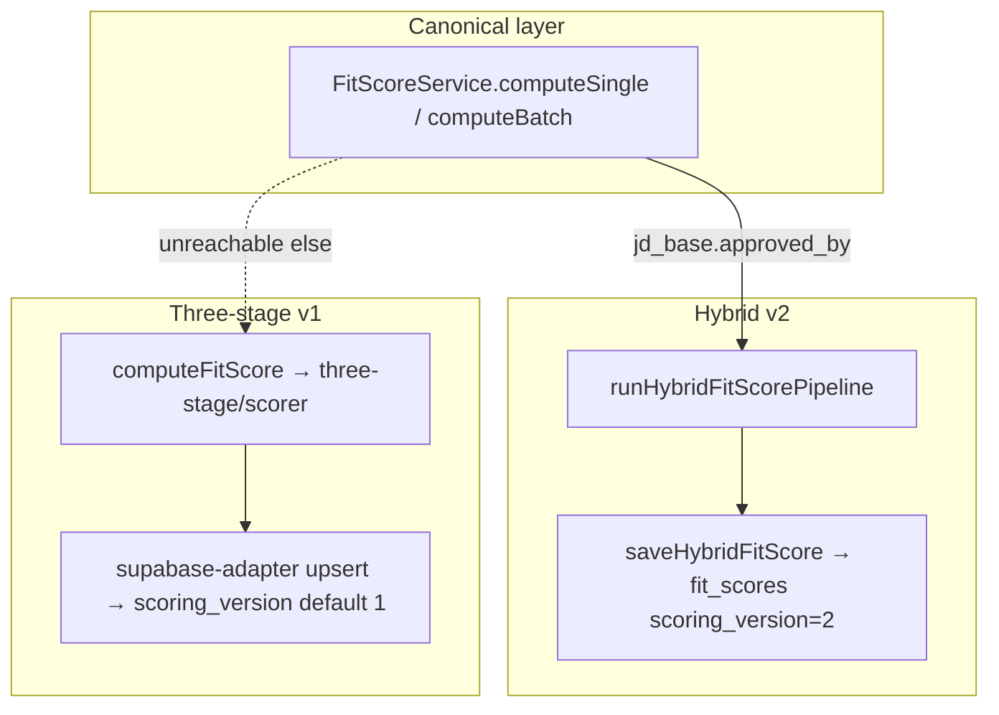

# Scoring path audit — entrypoints and divergence

> **Superseded for current behavior (2026-05-18):** WhatsApp, email intake, and `FitScoreService` were unified on hybrid v2. See **[`docs/principles/scoring-entrypoints-current.md`](../principles/scoring-entrypoints-current.md)** — canonical inventory. This file is kept for the May 2026 audit record and ticket stubs.

| Status                           | **Historical audit** — superseded by `scoring-entrypoints-current.md`                                                                              |
| -------------------------------- | -------------------------------------------------------------------------------------------------------------------------------------------------- |
| Date                             | 2026-05-16                                                                                                                                         |
| Branch audited                   | `dev` @ `96bb741` (post Brief 5)                                                                                                                   |
| Canonical entry (principle)      | `scoreCandidateForJob(jobId, candidateId, context)` — **not a named function today**                                                               |
| Canonical entry (implementation) | `FitScoreService.computeSingle` / `computeBatch` in `src/lib/services/FitScoreService.ts`                                                          |
| Related prior audit              | [`docs/principles/scoring-coverage-audit-2026-05.md`](../principles/scoring-coverage-audit-2026-05.md) (surface inventory; still largely accurate) |

---

## Executive summary

**Production default for approved JD Base:** hybrid v2 via `runHybridFitScorePipeline` (persists `scoring_version: 2`, supersedes prior production rows).

**Legacy three-stage** still runs when code calls `computeFitScore` (`src/lib/fitscore/scorer.ts` → `three-stage/scorer.ts`). That path persists **`scoring_version` default 1** and **does not** enforce JD Base approval or `pending_jd_approval` queue semantics.

**Four WhatsApp modules** still call `computeFitScore` directly — the main **accidental divergence** called out in TH-SCORING-1. **Email intake** never scores (TH-SCORING-2). **Agency bulk** defers scoring by design (TH-SCORING-4).

**Additional divergence not in the four tickets:** dashboard “hybrid beta” routes `POST /api/fitscore/score` and `POST /api/fitscore/batch` call `runHybridFitScorePipeline` **directly**, bypassing `FitScoreService` (same pipeline, different gates/queue/deferred handling).

`FitScoreService.computeSingle` records `metric.scoring.path_used` as `hybrid` or `three_stage`, but after JD Base approval the **`three_stage` branch is unreachable** (dead code — TH-SCORING-3).

---

## Architecture reference

**JD Base gate (unified path only):** `getJdBaseByJobId` → if `!approvedBy`, default `onUnapprovedJdBase: "queue_pending"` enqueues `pending_jd_approval` and returns `{ scoring_status: "pending_jd_approval" }` without writing a scored row.

**Production row invariant:** reads use `.is("superseded_at", null)` (e.g. `FitScoreService.getLatestProductionScore`, hybrid `saveHybridFitScore`). Hybrid rescoring **supersedes** the active row then inserts a new one.

---

## Path inventory

### 1. WhatsApp apply / score

**Inbound:** `src/lib/whatsapp/handler.ts` → Meta webhook payload.

| Sub-path                                        | Trigger                                            | Scoring code path                                            | Pipeline                | JD Base gate            | Writes `fit_scores` (active)                       |
| ----------------------------------------------- | -------------------------------------------------- | ------------------------------------------------------------ | ----------------------- | ----------------------- | -------------------------------------------------- |
| **Lane A** (CV + `job_id` in session)           | `handleCVReceived` → `handleLaneASingleJobScore`   | `computeFitScore`                                            | Three-stage v1          | **No**                  | Yes (`scoring_version` 1); v2 row blocks overwrite |
| **Lane B — Scout bulk** (CV, no `job_id`)       | `runWhatsAppCvIngest` → loop open jobs             | `FitScoreService.computeSingle`                              | Hybrid v2 when approved | **Yes** (queue pending) | Yes v2                                             |
| **Role-guided flow** (pick role + related jobs) | `role-guided-flow.ts`                              | `computeFitScore` per job                                    | Three-stage v1          | **No**                  | Yes v1                                             |
| **Q&A → immediate match**                       | `qa-flow.ts` → `runImmediateMatchAfterPreferences` | `computeFitScore` per job (up to `MAX_IMMEDIATE_MATCH_JOBS`) | Three-stage v1          | **No**                  | Yes v1                                             |
| **Job published alerts**                        | `JobService` → `onJobPublished` / cron             | `job-alert.ts` → `computeFitScore`                           | Three-stage v1          | **No**                  | Yes v1                                             |
| **Apply from match** (reply 1/2/3)              | `application-bridge.ts`                            | **No new score** — attaches existing `fit_scores.id`         | N/A                     | N/A                     | N/A                                                |

**Walk-through (Lane A — the drift case):**

1. `handler.ts` `handleCVReceived` → `handleLaneASingleJobScore(scoutInput, jobId)`
2. `lane-a.ts` → `runWhatsAppCvIngest` (CV parse, candidate upsert)
3. `computeFitScore(supabase, jobData, candidateForScore)` → `scorer.ts` → `three-stage/scorer.ts`
4. `createSupabaseFitScoreAdapter` upserts `fit_scores` (skips update if existing `scoring_version === 2`)
5. Lane A reads back `overall_score` / `skills_score` for WhatsApp templates

**Referral on WhatsApp:** `referral-handler.ts` sets session context and copy only. Scoring happens on the **same branches above** after CV ingest — no separate referral scorer.

---

### 2. Dashboard / pipeline upload

| Entry                                | Route / UI                                                            | Scoring                                                                                            |
| ------------------------------------ | --------------------------------------------------------------------- | -------------------------------------------------------------------------------------------------- |
| **Agency single upload**             | `POST /api/agency/upload-profile` → `processPublicApplication`        | `FitScoreService.computeSingle` per approved job (inside `processCandidate`)                       |
| **Agency bulk upload**               | `POST /api/agency/upload-profile/bulk` → `savePublicApplication` only | **None** at ingest — operator must run **Score Pending** (`reprocess-candidates`)                  |
| **Agency pipeline UI**               | `agency/pipeline/page.tsx` → same upload routes                       | Same as above                                                                                      |
| **Public apply (recruit marketing)** | `POST /api/apply` → `processPublicApplication`                        | Unified                                                                                            |
| **Manual rescore (job matches)**     | `recruit/jobs/[id]/matches` → `POST /api/fitscore/batch`              | `runHybridFitScorePipeline` **direct** (feature flag + JD approved); not `FitScoreService`         |
| **Manual rescore (legacy API)**      | `POST /api/fit-score` sync/async                                      | `FitScoreService.computeSingle` / `computeBatch` or Inngest `fit-score-single` / `fit-score-batch` |
| **Agency “Score now”**               | `agency/candidates/[id]` → `POST /api/agency/reprocess-candidates`    | Parse + `FitScoreService.computeSingle` per client job                                             |

There is **no separate “recruiter pipeline CV upload” scorer** in code — recruiter-side uploads go through **agency upload** or **applications / apply** patterns.

---

### 3. Email intake

| Entry           | `POST /api/intake/email`                                                                    |
| --------------- | ------------------------------------------------------------------------------------------- |
| Save path       | `savePublicApplication` only (fast path, same as bulk)                                      |
| Scoring         | **None** — no `FitScoreService`, no `enqueue("fit-score-single")`, no `pending_jd_approval` |
| Acknowledgement | `notifyCvIngestedFromEmailIntake` only                                                      |

**Gap:** Relative to [scoring coverage principle](../principles/scoring-coverage.md), this is a **missing** scorer invocation unless operators always run reprocess manually.

---

### 4. Referral attribution (web)

| Entry                                | Scoring                                                                                                             |
| ------------------------------------ | ------------------------------------------------------------------------------------------------------------------- |
| `POST /api/apply` with `?ref=`       | `processPublicApplication` → `resolveReferralToken` → same `processCandidate` → **`FitScoreService.computeSingle`** |
| Agency upload with referral metadata | Same via `processPublicApplication` when used                                                                       |

Referral affects **attribution rows**, not a different scoring stack.

---

### 5. Batch rescore

| Trigger                                      | Entrypoint                                                                                  | Implementation                                                 |
| -------------------------------------------- | ------------------------------------------------------------------------------------------- | -------------------------------------------------------------- |
| **Inngest explicit list**                    | Event `fit-score/batch`                                                                     | `FitScoreService.computeBatch` (`src/inngest/functions.ts`)    |
| **POST /api/fit-score** (batch body, inline) | Same service, capped list + safety margin                                                   | Hybrid when JD approved                                        |
| **POST /api/fit-score** (async, large batch) | `enqueue("fit-score-batch")` → Inngest → `runFitScoreBatchAgent` or explicit `computeBatch` | Unified                                                        |
| **POST /api/fitscore/batch** (hybrid UI)     | `runHybridFitScorePipeline` per candidate **in route**                                      | Hybrid v2 direct; 428 if JD not approved                       |
| **Semantic batch agent**                     | `runFitScoreBatchAgent` (`fitscore-agent.ts`)                                               | `FitScoreService.computeSingle` per pair (embedding shortlist) |
| **Agency reprocess**                         | `POST /api/agency/reprocess-candidates`                                                     | Parse CV + `FitScoreService.computeSingle`                     |
| **Agency rescore**                           | `POST /api/agency/rescore-candidates`                                                       | `FitScoreService.computeSingle` (no re-parse)                  |
| **JD Base approved sweep**                   | `pending-jd-approval.ts` → `computeBatch`                                                   | Unified                                                        |

---

## Divergence matrix

| Caller                                                                | Uses canonical `FitScoreService`?    | Pipeline       | JD Base / pending queue          | Notes                                |
| --------------------------------------------------------------------- | ------------------------------------ | -------------- | -------------------------------- | ------------------------------------ |
| `public-apply` / `POST /api/apply`                                    | Yes                                  | Hybrid v2      | Yes                              | Reference behavior                   |
| `POST /api/applications` + Inngest                                    | Yes                                  | Hybrid v2      | Yes                              |                                      |
| `POST /api/agency/upload-profile`                                     | Yes                                  | Hybrid v2      | Yes                              |                                      |
| `POST /api/agency/upload-profile/bulk`                                | No (by design at ingest)             | —              | No at ingest                     | TH-SCORING-4                         |
| `POST /api/intake/email`                                              | No                                   | —              | No                               | TH-SCORING-2                         |
| WhatsApp `lane-a`, `immediate-match`, `job-alert`, `role-guided-flow` | **No** → `computeFitScore`           | Three-stage v1 | **No**                           | TH-SCORING-1                         |
| WhatsApp Scout (`runWhatsAppCvIngest` job loop)                       | Yes                                  | Hybrid v2      | Yes                              |                                      |
| `POST /api/fit-score` (single/batch)                                  | Yes                                  | Hybrid v2      | Yes (route pre-check + service)  |                                      |
| `POST /api/fitscore/score`                                            | **No** → `runHybridFitScorePipeline` | Hybrid v2      | Throws if no approval (no queue) | Parallel entry                       |
| `POST /api/fitscore/batch`                                            | **No** → `runHybridFitScorePipeline` | Hybrid v2      | 428 if not approved              | Job matches UI                       |
| `fitscore-agent` / Inngest batch                                      | Yes                                  | Hybrid v2      | Yes                              | Unused `computeFitScore` import only |

### Why bypasses exist

| Bypass                                         | Historical reason                                                                |
| ---------------------------------------------- | -------------------------------------------------------------------------------- |
| WhatsApp → `computeFitScore`                   | Predates hybrid v2 + JD Base package; Lane A / alerts never migrated             |
| `/api/fitscore/*` → direct hybrid              | Hybrid v2 beta endpoints added with feature flag; duplicated JD check in route   |
| Email / bulk fast path                         | Intentional latency/timeout tradeoff; scoring deferred to operator or other jobs |
| Dead `three_stage` branch in `FitScoreService` | Guard structure queues/rejects **before** branch; else never runs                |

### If everything routed through `FitScoreService.computeSingle`

| Effect                          | Detail                                                                                                |
| ------------------------------- | ----------------------------------------------------------------------------------------------------- |
| WhatsApp                        | Same hybrid v2 + `pending_jd_approval` as web; WhatsApp copy may need “awaiting HM approval” handling |
| v1 retirement                   | Natural as WhatsApp migrates; existing v1 rows remain until rescored                                  |
| `/api/fitscore/score` + `batch` | Should delegate to service for consistent deferred/queue metrics                                      |
| No change to bulk ingest speed  | Still `savePublicApplication` only; follow-up must call service (TH-SCORING-4)                        |

**Product question (do not decide tired):** Should WhatsApp score when JD Base is missing — **queue silently**, **message user**, or **block**? Unified path defaults to queue; three-stage today scores anyway.

---

## v1 vs v2 coexistence

| Aspect               | Three-stage (`computeFitScore`)                          | Hybrid v2 (`runHybridFitScorePipeline`)           |
| -------------------- | -------------------------------------------------------- | ------------------------------------------------- |
| `scoring_version`    | DB default **1**                                         | Explicit **2**                                    |
| Supersede on rescore | Update same row (unless v2 exists — then **skip write**) | Supersede active row, insert new                  |
| JD Base required     | No                                                       | Yes                                               |
| Metrics              | No `recordScoringPathMetric`                             | Via service when called through `FitScoreService` |

**QA Engineer job “10 legacy v1 candidates”:** Operational data — rescoring via `FitScoreService` or job matches batch produces v2 rows and supersedes v1.

---

## Parked tickets — scoped to code

### TH-SCORING-1 — Migrate WhatsApp to unified scorer

| Field          | Detail                                                                                                                                                                                                                                                            |
| -------------- | ----------------------------------------------------------------------------------------------------------------------------------------------------------------------------------------------------------------------------------------------------------------- |
| **Files**      | `src/lib/whatsapp/lane-a.ts`, `immediate-match.ts`, `job-alert.ts`, `role-guided-flow.ts`                                                                                                                                                                         |
| **Change**     | Replace `import { computeFitScore } from "@/lib/fitscore/scorer"` with `FitScoreService.computeSingle(admin, jobId, candidateId, { saveToDb: true, onUnapprovedJdBase: "queue_pending" })`; use `numericOverallFromFitScoreServiceResult` for template thresholds |
| **Call sites** | ~6–12 awaits across loops (immediate match + role-guided related jobs are the heavy ones)                                                                                                                                                                         |
| **Tests**      | Extend WhatsApp unit tests; one integration path per module                                                                                                                                                                                                       |
| **Effort**     | **4–8 hours** (code + QA + latency check on immediate-match multi-job loop)                                                                                                                                                                                       |
| **Risk**       | UX when JD not approved; jobs previously scored with v1 may need rescore to compare apples-to-apples                                                                                                                                                              |

### TH-SCORING-2 — Email intake scoring

| Field          | Detail                                                                                                                                                                                 |
| -------------- | -------------------------------------------------------------------------------------------------------------------------------------------------------------------------------------- |
| **Files**      | `src/app/api/intake/email/route.ts` (+ optionally shared helper in `public-apply.ts`)                                                                                                  |
| **Change**     | After successful `savePublicApplication`, either `await enqueue("fit-score-single", { jobId, candidateId })` (preferred) or `FitScoreService.computeSingle` with same options as apply |
| **Effort**     | **1–3 hours**                                                                                                                                                                          |
| **Acceptance** | Intake creates `pending_jd_approval` when JD not approved; no silent unscored eligible pairs                                                                                           |

### TH-SCORING-3 — FitScoreService cleanup

| Field      | Detail                                                                                                                                                                      |
| ---------- | --------------------------------------------------------------------------------------------------------------------------------------------------------------------------- |
| **Files**  | `src/lib/services/FitScoreService.ts`, `src/lib/agents/scout.ts`, `src/lib/agents/fitscore-agent.ts`                                                                        |
| **Change** | Remove unreachable `computeFitScore` branches after JD gate; drop unused `computeFitScore` imports; fix misleading log `scoring_pipeline: "hybrid_v2"` when branch was dead |
| **Effort** | **30–60 minutes**                                                                                                                                                           |
| **Note**   | Safe to ship with TH-SCORING-1 or alone                                                                                                                                     |

### TH-SCORING-4 — Agency bulk Score Pending invariant

| Field            | Detail                                                                                                                                                                        |
| ---------------- | ----------------------------------------------------------------------------------------------------------------------------------------------------------------------------- |
| **Files**        | `src/app/api/agency/upload-profile/bulk/route.ts`, agency pipeline UI, optionally cron/alert                                                                                  |
| **Change**       | Document + enforce: bulk rows reach `FitScoreService` within SLA (UI badge, blocked pipeline stage, or scheduled sweep for `processing_status` / missing active `fit_scores`) |
| **Effort**       | **4–12 hours** depending on enforcement depth (docs-only vs alerts vs auto-enqueue)                                                                                           |
| **Not in scope** | Inline scoring in bulk request (explicitly rejected in principle)                                                                                                             |

### Optional follow-on (not TH-SCORING-\*)

| Item                                                         | Files                                                   | Effort                                           |
| ------------------------------------------------------------ | ------------------------------------------------------- | ------------------------------------------------ |
| Unify `/api/fitscore/score` + `batch` with `FitScoreService` | `src/app/api/fitscore/score/route.ts`, `batch/route.ts` | **2–4 hours**                                    |
| Rename/wrap `computeSingle` as `scoreCandidateForJob`        | `FitScoreService.ts` + re-exports                       | **1 hour** (cosmetic, helps principle alignment) |

---

## Effort summary (implementation, not audit)

| Ticket       | Estimate          | Confidence                             |
| ------------ | ----------------- | -------------------------------------- |
| TH-SCORING-1 | 4–8 h             | Medium (WhatsApp UX + multi-job loops) |
| TH-SCORING-2 | 1–3 h             | High                                   |
| TH-SCORING-3 | 0.5–1 h           | High                                   |
| TH-SCORING-4 | 4–12 h            | Low–medium (depends on enforcement)    |
| **All four** | **~1–3 dev days** | Not 4 hours total; not 4 weeks         |

Cheapest quick win after audit: **TH-SCORING-3**, then **TH-SCORING-2**, then **TH-SCORING-1** (highest impact).

---

## Suggested review checklist

1. Confirm WhatsApp should use **queue_pending** when JD Base unapproved (vs user-visible message).
2. Decide whether `/api/fitscore/*` unification is part of the same sprint or a fifth ticket.
3. For TH-SCORING-4, pick enforcement level: **docs**, **UI only**, or **automated enqueue sweep**.
4. Plan v1→v2 rescore for demo jobs (QA Engineer) after TH-SCORING-1 lands.

---

_Audit complete. No code changes. Re-validate after any scoring refactor._
