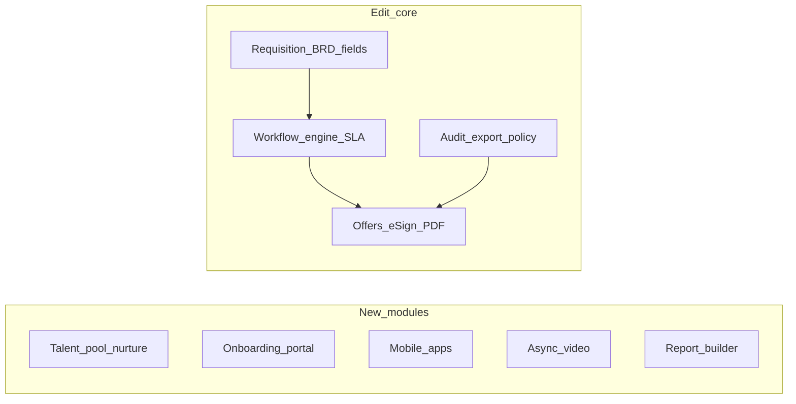

# Gap backlog: easy to hard, New vs Edit

**Sources:** Competitive gap narrative, [GAP-ANALYSIS-TigerHire-vs-BRD-PRD-and-implementation-plan.md](./GAP-ANALYSIS-TigerHire-vs-BRD-PRD-and-implementation-plan.md), and [PRODUCT_FEATURE_GAPS.md](../PRODUCT_FEATURE_GAPS.md).

## How to read this

- **Order:** Roughly **increasing complexity / blast radius** (quick wins first, platform-scale last).
- **New:** Mostly **additive** (new tables, routes, jobs, or parallel modules). Prefer before heavy refactors when effort is comparable.
- **Edit:** **Extends or corrects** existing APIs, statuses, workflows, or shared primitives. Typically **later** than a **New** item at a similar difficulty.

Some rows are **both** (new module + wiring into existing UI)—the tag reflects the dominant work.

---

## Implementation status (repo snapshot)

This is a **high-level code audit**, not a product sign-off. Treat **Partial** as “some building blocks exist; BRD completeness not claimed.”

### Latest rerun (2026-05-12)

- `npm run typecheck` => **exit 0 (clean)**. The 2026-04-18 list of API-route typing failures below has been resolved in the current tree — all six routes typecheck cleanly. Kept for audit history.
- Non-fixture oversize check (`src/**/*.ts(x)`, excluding `src/lib/mock/data_original.ts`) => **NONE > 1000 lines** (last verified 2026-04-18, not re-run).
- `npm run rate` => **94/100 (Elite)** (last verified 2026-04-18, not re-run).

#### Previously failing (2026-04-18, now resolved 2026-05-12)

- `src/app/api/admin/users/route.ts`
- `src/app/api/analytics/export/route.ts`
- `src/app/api/hiring-requests/route.ts`
- `src/app/api/messages/route.ts`
- `src/app/api/organisations/route.ts`
- `src/app/api/referral-campaigns/route.ts`

| #   | Status               | Repo notes (indicative)                                                                                                                                                                                                                                                                                               |
| --- | -------------------- | --------------------------------------------------------------------------------------------------------------------------------------------------------------------------------------------------------------------------------------------------------------------------------------------------------------------- |
| A1  | Partial              | Dwell/TAT API + UI exist: `GET /api/analytics/stage-dwell`, `src/lib/analytics/stage-dwell.ts`, and recruit analytics UI. Remaining gap is **CSV export** — `GET /api/analytics/export` `ALLOWED_METRICS` does not include dwell/TAT yet. (Re-verified 2026-05-12)                                                    |
| A2  | Shipped              | Inngest `application-deadline-reminders` + helpers in `src/lib/jobs/application-deadline-reminders.ts`.                                                                                                                                                                                                               |
| A3  | Partial              | Apply flows exist; dedicated re-apply / cooling-off policy not surfaced as first-class.                                                                                                                                                                                                                               |
| A4  | Partial              | Candidate/job surfaces vary; full “views + match touches” analytics not consolidated.                                                                                                                                                                                                                                 |
| A5  | Partial              | Search exists; boolean/advanced builder scope unclear vs gap.                                                                                                                                                                                                                                                         |
| A6  | Partial              | Saved lists / talent concepts fragmented vs dedicated list entity.                                                                                                                                                                                                                                                    |
| A7  | Partial              | Screening/FitScore dimensions; productized “culture fit” template type TBD.                                                                                                                                                                                                                                           |
| A8  | Not started          | No i18n shell tracked as product-wide.                                                                                                                                                                                                                                                                                |
| A9  | Partial              | Profile fields / CV extract; portfolio as first-class entity TBD.                                                                                                                                                                                                                                                     |
| A10 | Partial              | Assessments path exists; verified-skills product surface TBD.                                                                                                                                                                                                                                                         |
| A11 | Not started          | No market-benchmark vendor integration in tree.                                                                                                                                                                                                                                                                       |
| A12 | Not started          | No dedicated FAQ chatbot route.                                                                                                                                                                                                                                                                                       |
| A13 | Not started          | No company comparison module.                                                                                                                                                                                                                                                                                         |
| A14 | Partial              | Offer/approval mailers and tokens; full “one-click approver” polish varies by flow.                                                                                                                                                                                                                                   |
| A15 | Partial              | Public/OTP-gated offer access patterns in offers stack; tighten vs BRD as needed.                                                                                                                                                                                                                                     |
| A16 | Partial              | Hiring-offer workflow + statuses (`negotiating` vs `pending_finance`, etc.); align semantics with data.                                                                                                                                                                                                               |
| A17 | Partial              | `offerBgvTrigger` in `src/inngest/functions.ts` calls `initiateSpringVerifyForApplication` (real SpringVerify path when env is configured, not a stub). End-to-end "workflow complete" still partial; depends on B3. (Re-verified 2026-05-12)                                                                         |
| B1  | Partial              | Offer send/finance/audit path; third-party e-sign webhooks not the main spine yet.                                                                                                                                                                                                                                    |
| B2  | Partial              | Settings offer-letter templates + PDF-oriented flow; versioning depth TBD.                                                                                                                                                                                                                                            |
| B3  | Partial              | SpringVerify initiate + webhook path exists; post-accept trigger/workflow completion still partial (see A17).                                                                                                                                                                                                         |
| B4  | Not started          | No LinkedIn ingest product path.                                                                                                                                                                                                                                                                                      |
| B5  | Partial              | HRIS validate + `executeHrisSync`, `/api/settings/org/integrations/hris/sync`, Workday validator all present. Full ATS/HRMS platform breadth (multi-vendor mapping, webhooks, idempotency) is the remaining gap. (Re-verified 2026-05-12)                                                                             |
| B6  | Partial              | Headcount plans API + sync endpoint + validation exist; broader HRMS finance connector remains partial.                                                                                                                                                                                                               |
| B7  | Shipped              | Compensation bands settings + validation on offer create/send (see settings + offers APIs).                                                                                                                                                                                                                           |
| B8  | Partial              | Hiring requests API/UI extended (e.g. on-hold); full BRD requisition parity TBD.                                                                                                                                                                                                                                      |
| B9  | Partial              | Finance gate exists; multi-tier parallel approvers generalized TBD.                                                                                                                                                                                                                                                   |
| B10 | Not started          | No nurture/campaign engine.                                                                                                                                                                                                                                                                                           |
| B11 | Not started          | No onboarding module.                                                                                                                                                                                                                                                                                                 |
| B12 | Not started          | No custom report builder.                                                                                                                                                                                                                                                                                             |
| B13 | Not started          | No DEI reporting / anonymised mode productized.                                                                                                                                                                                                                                                                       |
| B14 | Not started          | No skills ontology master data.                                                                                                                                                                                                                                                                                       |
| B15 | Not started          | No async video interview product.                                                                                                                                                                                                                                                                                     |
| B16 | Not started          | No native mobile apps.                                                                                                                                                                                                                                                                                                |
| C1  | Partial              | Hiring-offer audit helpers + UI + CSV export exist; policy completeness and access harmonization still TBD.                                                                                                                                                                                                           |
| C2  | Partial              | `workflow-sla` cron + workflow tables; SLA escalation engine vs BRD TBD. **Offer expiry:** `src/app/api/cron/offer-expiry/route.ts` scheduled in `vercel.json` (`0 */6 * * *`).                                                                                                                                       |
| C3  | Partial (infra only) | `workflow_instances` is used for requisition + offer-finance flows, but definitions are **code-enumerated** (e.g. `offer_finance_v1` single admin stage in `offer-finance-approval-definitions.ts`), not an admin-configurable multi-tier engine. Infra in place; product surface still TBD. (Re-verified 2026-05-12) |
| C4  | Partial              | Orchestrator agent exists; user-defined automation product TBD.                                                                                                                                                                                                                                                       |
| C5  | Not started          | Enterprise dashboards for traceability/SLA TBD.                                                                                                                                                                                                                                                                       |
| C6  | Partial              | Requisition delegations routes exist; cross-workflow proxy/delegation parity remains TBD.                                                                                                                                                                                                                             |
| C7  | Not started          | Localized offer templates TBD.                                                                                                                                                                                                                                                                                        |

---

## Tier A — Smaller scope (days to low weeks)

| #   | Gap                                                                                   | New / Edit | Why this tier                                                                                                      |
| --- | ------------------------------------------------------------------------------------- | ---------- | ------------------------------------------------------------------------------------------------------------------ |
| A1  | **Time-in-stage / stage TAT analytics** (export + dashboard)                          | **Edit**   | New SQL/views + extend `src/app/api/analytics` — no new vendor; today’s views are funnel + time-to-hire, not dwell |
| A2  | **Application deadline reminders**                                                    | **New**    | Inngest + notification templates; touches applications only                                                        |
| A3  | **Re-apply / cooling-off rules** (same company)                                       | **Edit**   | Rules on existing apply/application APIs                                                                           |
| A4  | **Application analytics** (views, match touches) for candidate                        | **Edit**   | Instrumentation + read APIs on existing entities                                                                   |
| A5  | **Boolean / advanced search** (saved searches, recruiter sourcing)                    | **Edit**   | Query builder + validation on existing search                                                                      |
| A6  | **Saved candidate lists** (beyond “basic”)                                            | **New**    | New list entity + UI; plugs into existing candidates                                                               |
| A7  | **Culture fit / extra assessment dimensions** (productized, not just screening agent) | **New**    | New template type or assessment dimension if kept separate                                                         |
| A8  | **Multi-language UI** (i18n shell + key locales)                                      | **New**    | Framework + content; large copy surface, medium code risk                                                          |
| A9  | **Portfolio / projects on candidate profile**                                         | **New**    | Schema + UI + optional AI extract                                                                                  |
| A10 | **Skills quiz / verified skills**                                                     | **New**    | New assessment-like surface or extend assessments                                                                  |
| A11 | **Salary insights / market benchmarking** (vendor or static tables)                   | **New**    | Usually third-party data + new UI; integration complexity varies                                                   |
| A12 | **Chatbot FAQ** (public or candidate)                                                 | **New**    | New route + RAG or canned flows                                                                                    |
| A13 | **Company comparison / culture tools**                                                | **New**    | Greenfield UX + data model                                                                                         |
| A14 | **Email deep-link approvals** (one-time tokens for approvers) — G-P1-3                | **Edit**   | Extends offer/requisition approval UX + mailer                                                                     |
| A15 | **OTP / magic-link public offer view** (no full account) — G-P0-5                     | **Edit**   | New public routes + security model, tied to offers/notifications                                                   |
| A16 | **Counter-offer workflow fix** (semantics vs `approved`) — G-P2                       | **Edit**   | Small surface, high correctness risk on `src/app/api/offers`                                                       |
| A17 | **BGV trigger** (post-accept hook) — G-P2 / F-19                                      | **Edit**   | Hook + status; vendor integration is separate (B3)                                                                 |

---

## Tier B — Integrations and compliance-shaped (weeks)

| #   | Gap                                                                                | New / Edit         | Why this tier                                      |
| --- | ---------------------------------------------------------------------------------- | ------------------ | -------------------------------------------------- |
| B1  | **E-signature** (DocuSign / Dropbox Sign / Adobe) for offers — G-P0-4              | **Edit**           | Offers + audit + webhooks; vendor contract         |
| B2  | **Offer letter PDF generation + versioning** — G-P0-4 / Phase 3                    | **Edit**           | Templates + storage + ties to offers               |
| B3  | **Background check vendor** (Checkr, Sterling, …) + pipeline stage                 | **New** + **Edit** | New integration service + pipeline stage semantics |
| B4  | **LinkedIn / social sourcing** (Easy Apply ingest, profile enrichment)             | **New**            | OAuth + compliance + product policy; heavy         |
| B5  | **ATS / HRMS sync** (webhooks, CSV, Workday-style) — G-P1-5                        | **New**            | Integration platform; mapping + idempotency        |
| B6  | **HRMS headcount/budget read-only for Finance**                                    | **New** + **Edit** | Connector + finance UI context                     |
| B7  | **Configurable compensation bands + exception path** — G-P0-3                      | **Edit**           | Validation engine + offer workflow                 |
| B8  | **Hiring requisition BRD completeness** (REQ-ID, Draft→Submitted, fields) — G-P1-1 | **Edit**           | Extends `src/app/api/hiring-requests` + UI         |
| B9  | **Multi-tier offer approval** (Legal, C&B, CHRO, parallel gates) — G-P1-2          | **Edit**           | Generalizes today’s finance gate                   |
| B10 | **Talent pool / nurture** (drip, re-engagement silver medalists)                   | **New**            | Campaign engine + consent + messaging volume       |
| B11 | **Onboarding module** post-accept (checklists, new-hire portal)                    | **New**            | New subdomain of product                           |
| B12 | **Custom report builder + scheduled delivery**                                     | **New**            | BI-style product                                   |
| B13 | **DEI reporting + anonymised screening mode**                                      | **New** + **Edit** | Reporting + pipeline/FitScore display rules        |
| B14 | **Skills taxonomy / ontology** (framework-wide)                                    | **New** + **Edit** | Master data + retro-fit jobs/FitScore              |
| B15 | **Async one-way video interviews** (HireVue-class)                                 | **New**            | Storage, player, review UX, compliance             |
| B16 | **Native mobile apps** (iOS/Android)                                               | **New**            | Parallel clients + push infra                      |

---

## Tier C — Platform / workflow engine (multi-week to quarter+)

| #   | Gap                                                                                       | New / Edit | Why this tier                                                                        |
| --- | ----------------------------------------------------------------------------------------- | ---------- | ------------------------------------------------------------------------------------ |
| C1  | **Immutable hiring/offer audit completeness** (export CSV/PDF, HM read policy, reminders) | **Edit**   | Extends `src/lib/audit/hiring-offer-audit.ts` + APIs                                 |
| C2  | **SLA / escalation engine** (50/90/100/200%, escalation targets) — G-P0-2                 | **Edit**   | Builds on `workflow_instances` / `workflow_stages` + `src/app/api/cron/workflow-sla` |
| C3  | **Configurable multi-tier workflow engine** (req + offer, sequential then parallel)       | **Edit**   | Replaces one-off gates with generic engine                                           |
| C4  | **Orchestrator vs “workflow rules”** (user-defined automation, not fixed agent steps)     | **Edit**   | Product + technical decision on `src/lib/agents/orchestrator.ts`                     |
| C5  | **Enterprise measurement dashboards** (time-to-offer, traceability score, SLA breach)     | **Edit**   | Analytics + audit completeness dependency                                            |
| C6  | **Delegation / proxy approvers** — G-P2                                                   | **Edit**   | Workflow + security model                                                            |
| C7  | **Multi-language offer templates** — G-P2                                                 | **Edit**   | Template system + localization                                                       |

---

## Suggested sequencing

Within a **similar size band**, prefer **New** items (A2, A6, A9–A13, B3’s vendor adapter, B5, B10–B16) before **Edit** items that reshape core tables (A1, A15, A16, B1–B2, B7–B9, C1–C7).

**Practical compromise:** Ship **B1 e-sign** and **B2 PDF** early even though tagged **Edit**, because they unlock revenue/compliance and offer codepaths are centralized.

---

## Dependency sketch

---

## Out of scope (not gaps / narrative-only)

Zoom/Daily for booked interviews, WhatsApp, SCIM Users, distribution engine, referrer OTP, etc.—validate in code before treating as gaps.

---

## GitHub issues export

See [GAP-BACKLOG-github-issues.md](./GAP-BACKLOG-github-issues.md) for suggested **title**, **labels**, and **body** snippets per row (create issues manually or with `gh issue create`).
