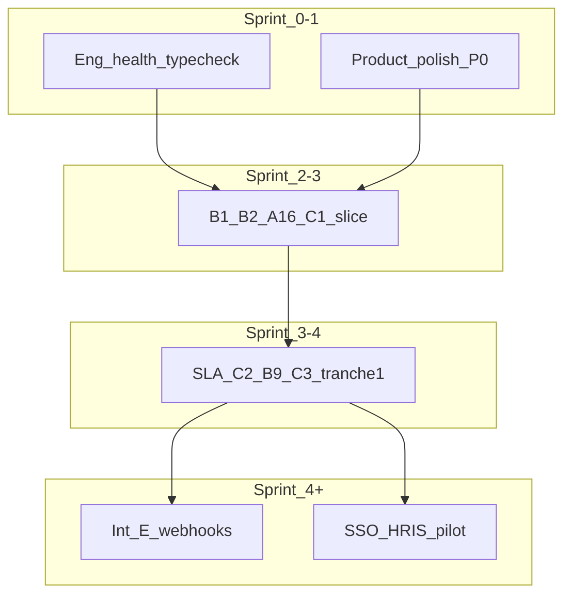

# Sprint plan: backlog (pending) to complete

**Purpose:** Time-boxed, sequenced delivery plan to move the highest-priority **partial** and **not started** work to **complete**, aligned with [GAP-BACKLOG-ordered-new-vs-edit.md](./GAP-BACKLOG-ordered-new-vs-edit.md), [PRODUCT-POLISH-BACKLOG.md](./PRODUCT-POLISH-BACKLOG.md), and P0 areas in [ATS-PARTIAL-GAPS-BACKLOG.md](./ATS-PARTIAL-GAPS-BACKLOG.md). Use alongside [FEATURE-BACKLOGS-MASTER.md](./FEATURE-BACKLOGS-MASTER.md) for where items are tracked.

**Conventions:** Gap IDs (A1, B1, …) are from the ordered gap doc. **ATS §n** = section in the ATS partial backlog. Epics: [ATS-EPICS-BACKLOG.md](./ATS-EPICS-BACKLOG.md).

**Definition of done (each slice):** Code and tests as appropriate; [FEATURE-INVENTORY-LIVING.md](./FEATURE-INVENTORY-LIVING.md) updated; gap / ATS row updated in the same change; P0 or compliance: product or security sign-off where required.

**Assumptions:** 2-week sprints; one primary delivery thread (parallel tracks for bugs/support OK).

**Last updated:** 2026-04-24

---

## Program overview

---

## Sprint 0 (weeks 1–2) — Foundation and trust

**Theme:** Quality bar + credible UX. No new enterprise integrations until listed surfaces pass exit criteria.

| Track                     | Work                                                                                                                                                                                                                                                                                           | Maps to                                                       | Exit (done)                                                                    |
| ------------------------- | ---------------------------------------------------------------------------------------------------------------------------------------------------------------------------------------------------------------------------------------------------------------------------------------------- | ------------------------------------------------------------- | ------------------------------------------------------------------------------ |
| A — Engineering           | `npm run typecheck` clean; periodically re-check routes historically called out: `api/admin/users`, `analytics/export`, `hiring-requests`, `messages`, `organisations`, `referral-campaigns`                                                                                                   | [FEATURE-BACKLOGS-MASTER.md](./FEATURE-BACKLOGS-MASTER.md) §5 | `npm run typecheck` passes; fix regressions in those routes as they appear     |
| B — Product polish **P0** | [DashboardShell](../../src/components/dashboard/DashboardShell.tsx) + **empty / error / retry** on: hiring requests, jobs, pipeline, candidate pool, company org overview; **skeletons** (no “empty” flash) where listed; **honest copy** for requisitions → jobs, apply, screening, approvals | [PRODUCT-POLISH-BACKLOG.md](./PRODUCT-POLISH-BACKLOG.md) P0   | Manual pass on each route: load, error, empty, and happy path feel intentional |

**Sprint 0 do-not-do:** New HRIS sync, generic multi-tenant workflow engine, or custom report builder (per polish-first rule in PRODUCT-POLISH-BACKLOG).

**Verification (2026-04-24):** `npm run typecheck` succeeded on main `tsconfig.typecheck.json` in this repo; treat route list as a **recheck list** on future audits, not a claim of current failure.

**Sprint 0 track B — UI work (in-repo, when shipping):** These complete PRODUCT-POLISH P0 for the main recruiter/company list surfaces. Several pages already have error+retry, empty states, and skeletons; the gaps to close in code are:

| Surface                        | File                                                     | Status (2026-04-24)                                                                                                                                                                       |
| ------------------------------ | -------------------------------------------------------- | ----------------------------------------------------------------------------------------------------------------------------------------------------------------------------------------- |
| Hiring requests (recruiter)    | `src/app/(dashboard)/recruit/hiring-requests/page.tsx`   | **Shipped:** list **loading** uses **skeleton cards** (row-shaped placeholders) instead of a center spinner.                                                                              |
| Company org overview           | `src/app/(dashboard)/company/page.tsx`                   | **Shipped:** `useApiQuery` **error** + `refetch` for jobs + overview; **error panel + Retry** when either fails; **`CompanyDashboardSkeleton`** for initial load (stats + report blocks). |
| Jobs, pipeline, candidate pool | `recruit/jobs`, `recruit/pipeline`, `recruit/candidates` | Unchanged: already P0 (skeletons, error+retry, empty+next). Re-verify on each release.                                                                                                    |

---

## Sprint 1 (weeks 3–4) — Polish P1 and quick “partial” wins

**Theme:** Coherence and low-blast-radius gaps.

| Priority | Work                                                                | Maps to     | Exit / status (2026-04-24)                                                                                                                                                                                                                     |
| -------- | ------------------------------------------------------------------- | ----------- | ---------------------------------------------------------------------------------------------------------------------------------------------------------------------------------------------------------------------------------------------- |
| 1        | **Product polish P1:** primary path; settings vs API; notifications | Polish P1   | **Ongoing:** candidate applications (above); **outbound webhooks** first-party UI: `src/app/(dashboard)/company/settings/outbound-webhooks/page.tsx` (list, add, enable, delete, one-time secret copy) + sidebar + link from **Integrations**. |
| 2        | **A3** re-apply / cooling-off in apply + application APIs           | A3 Partial  | **Shipped:** `code`, `retryAfter` + `retryAfterIso` on 403; GET `/api/apply/[slug]` has `reapplyPolicy`; public apply page + tests for `getPublicReapplyPolicyPayload`.                                                                        |
| 3        | **A14** one-click / deep-link approver                              | A14 Partial | `src/app/api/approvals/action/[token]/route.ts` (HTML confirm + POST). Further UAT per BRD.                                                                                                                                                    |

**Stretch:** **A1** scoping (TAT / time-in-stage design + view stub) or **A5** boolean search spike.

---

## Sprint 2 (weeks 5–6) — Offer spine (revenue / compliance)

**Theme:** [GAP-BACKLOG-ordered](./GAP-BACKLOG-ordered-new-vs-edit.md) **practical compromise:** ship **B1** e-sign and **B2** PDF early; fix **A16** semantics; extend **C1** audit export for offers.

| Order | Work                                                                                  | Maps to     | Exit                                                               |
| ----- | ------------------------------------------------------------------------------------- | ----------- | ------------------------------------------------------------------ |
| 1     | **A16** counter-offer / negotiation state machine; no invalid shortcuts to `approved` | A16, ATS §7 | Tests + [offers API](../../src/app/api/offers) behavior documented |
| 2     | **B2** offer letter PDF templates + versioning (product scope agreed)                 | B2, ATS §7  | Immutable version on send; hash stored per inventory               |
| 3     | **B1** e-sign vendor + audit hooks                                                    | B1          | E2E sign in staging                                                |
| 4     | **C1** slice: immutable offer events; CSV (PDF if required) per offer id              | C1, ATS §10 | Audit sample for dry run                                           |

---

## Sprint 3 (weeks 7–8) — Platform workflow tranche 1

**Theme:** E-platform: shared SLA + multi-gate requisitions and offers. **C3** is multi-sprint; this sprint = **tranche 1** only (stages, approver groups, one pilot schema).

| Order | Work                                                                         | Maps to | Exit                                                           |
| ----- | ---------------------------------------------------------------------------- | ------- | -------------------------------------------------------------- |
| 1     | **C2** SLA/escalation: `workflow-sla` + workflow tables to agreed thresholds | C2      | One req + one offer path in staging (see ATS-EPICS E-platform) |
| 2     | **B9** generalize parallel/sequential approvers beyond single finance gate   | B9, B8  | At least one Legal / C&B / parallel scenario                   |
| 3     | **A17** + **B3** BGV post-accept closed-loop with chosen vendor              | A17, B3 | Staging E2E accept → BGV state                                 |

---

## Sprint 4 (weeks 9–10) — Outbound webhooks (E-webhooks)

| Work                                                                             | Exit / note                                                                                                 |
| -------------------------------------------------------------------------------- | ----------------------------------------------------------------------------------------------------------- |
| **First-party settings UI** (CRUD + secret on create)                            | **Shipped:** `company/settings/outbound-webhooks` — list, add, enable/disable, delete, copy signing secret. |
| Per-delivery persistence, **DLQ**, **admin replay**; delivery log                | Still backlog — pilot verifies `X-TigerHire-Signature` (see [API.md](../API.md)).                           |
| Security hardening: signed replay window in customer docs; optional IP allowlist | Per [ATS-EPICS-BACKLOG E-webhooks](./ATS-EPICS-BACKLOG.md)                                                  |

---

## Sprint 5 (weeks 11–12) — Integrations pilot (P0 tranche)

| Work                                                                                  | Exit                                |
| ------------------------------------------------------------------------------------- | ----------------------------------- |
| **SSO** hardening, SCIM/group mapping, session policy                                 | Runbook + one pilot                 |
| **HRIS** sync: employees or headcount + **reconciliation report**                     | Reconciliation accepted by customer |
| **Hire → HRIS** idempotent worker for one system                                      | E2E hire in staging                 |
| Optional: **multi-channel** distribution + status dashboard (ATS §4) if deal-critical | Per product                         |

---

## Sprint 6+ (quarter) — Deep backlog

Choose by revenue. Prefer **New** over **Edit** in the same size band (per ordered gap doc), except when B1/B2/C1/C2 are explicitly prioritized.

| Bucket               | Examples                                                                                               |
| -------------------- | ------------------------------------------------------------------------------------------------------ |
| Analytics / sourcing | **A1**, **A5**, **A6**, source quality (ATS §9)                                                        |
| IJP / referrals      | ATS §2–§3, referral payroll P0 where required                                                          |
| Screening v3         | ATS §5: funnel, exports, bulk, assessment E2E                                                          |
| Large new modules    | B10–B16: nurture, onboarding, report BI, DEI, ontology, async video, mobile (one per quarter per team) |
| C-track              | **C3** completion, **C4**–**C7**                                                                       |

---

## Operating rhythm (every sprint)

1. **Start:** Issues from [GAP-BACKLOG-github-issues.md](./GAP-BACKLOG-github-issues.md) and epic DRIs in [ATS-EPICS-BACKLOG.md](./ATS-EPICS-BACKLOG.md).
2. **During:** Do not ship UI that over-promises ([PRODUCT-POLISH-BACKLOG](./PRODUCT-POLISH-BACKLOG.md) guiding rule).
3. **End:** Update [FEATURE-INVENTORY-LIVING.md](./FEATURE-INVENTORY-LIVING.md) and the relevant gap or ATS table in the **same** PR as code.

## Suggested first issue batch (after Sprint 0)

- **A16, B1, B2, C1** (offer spine) per dependency note in GAP-BACKLOG-ordered (Workflow/Audit support Offers; ship B1/B2 early for revenue).

---

## Related

- [FEATURE-BACKLOGS-MASTER.md](./FEATURE-BACKLOGS-MASTER.md) — one-page index of all trackers.
- [SPRINT-PRD-MVP.md](./SPRINT-PRD-MVP.md) — separate PRD MVP track (F8, F1, F3); combine capacity carefully with this program.
