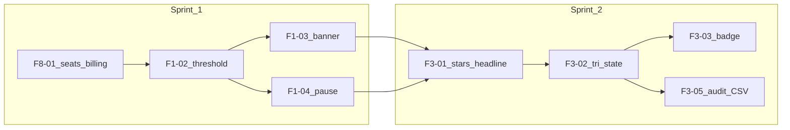

# Sprint plan — PRD MVP slice (F8, F1, F3)

**Assumptions:** Two 2-week sprints, one primary engineer on this slice (adjust velocity if parallelised).  
**Issue bodies and `gh` commands:** [PRD-FULL-GitHub-issues.md](./PRD-FULL-GitHub-issues.md)  
**Gap rows:** [PRD-FULL-Gap-Tracker-TigerHire-vs-GoPerfect.md](./PRD-FULL-Gap-Tracker-TigerHire-vs-GoPerfect.md)

---

## GitHub issue links (fill after creation)

| Tracker ID | GitHub issue | URL     |
| ---------- | ------------ | ------- |
| F8-01      | `#____`      | _paste_ |
| F1-02      | `#____`      | _paste_ |
| F1-03      | `#____`      | _paste_ |
| F1-04      | `#____`      | _paste_ |
| F3-01      | `#____`      | _paste_ |
| F3-02      | `#____`      | _paste_ |
| F3-03      | `#____`      | _paste_ |
| F3-05      | `#____`      | _paste_ |

---

## Dependency flow

Notes:

- **F1-03** depends on **F1-02** (bucket definitions drive counts).
- **F3-\*** can start after Sprint 1 lands or in parallel if F1 UI is not blocking shared components; diagram shows ideal sequencing.

---

## Sprint 1 (weeks 1–2)

| Order | Tracker ID | Summary                                                            | Effort | Milestone          |
| ----- | ---------- | ------------------------------------------------------------------ | ------ | ------------------ |
| 1     | **F8-01**  | Unlimited seats: billing + product audit (checklist in issue body) | S–M    | `PRD-MVP-sprint-1` |
| 2     | **F1-02**  | Threshold 1–5 → shortlist vs deprioritised                         | M      | `PRD-MVP-sprint-1` |
| 3     | **F1-03**  | Dashboard banner (received / shortlisted / deprioritised today)    | S–M    | `PRD-MVP-sprint-1` |
| 4     | **F1-04**  | Pause inbound screening per job                                    | S      | `PRD-MVP-sprint-1` |

**Effort key:** S = ~0.5–1.5 days, M = ~2–4 days, L = ~1+ week.

**Sprint 1 exit criteria**

- [ ] F8-01 closed: no contradiction between PRD seat policy and billing/team UX; audit checklist completed.
- [ ] F1-02 closed: threshold persisted; buckets queryable for UI.
- [ ] F1-03 closed: banner shows counts with agreed “today” and scope rules.
- [ ] F1-04 closed: pause/resume documented and wired into apply/score path.

---

## Sprint 2 (weeks 3–4)

| Order | Tracker ID | Summary                                                | Effort           | Milestone          |
| ----- | ---------- | ------------------------------------------------------ | ---------------- | ------------------ |
| 1     | **F3-01**  | Stars + headline + 3–5 bullets on score cards          | S                | `PRD-MVP-sprint-2` |
| 2     | **F3-02**  | Met / Partial / Not met + evidence per criterion       | M                | `PRD-MVP-sprint-2` |
| 3     | **F3-03**  | Consistency guarantee badge on job page                | S                | `PRD-MVP-sprint-2` |
| 4     | **F3-05**  | Scoring audit: scope ADR + minimal CSV (PDF follow-up) | L (narrow slice) | `PRD-MVP-sprint-2` |

**Sprint 2 exit criteria**

- [ ] F3-01 / F3-02 / F3-03 closed: HM-facing trust pattern visible on agreed surfaces.
- [ ] F3-05: either CSV export merged with documented event model, or spike + follow-up issue for implementation with clear carryover.

---

## Sprint 3 preview (do not commit in Sprint 2 unless velocity allows)

| Tracker ID  | Summary                                           | Effort |
| ----------- | ------------------------------------------------- | ------ |
| F2-01–F2-04 | NL briefing UI + criteria panel + re-score dialog | L      |
| F5-01       | Outreach sequence builder                         | L      |
| F1-01       | Multi-channel inbound worker (ATS, email parser)  | L      |
| F1-05       | p95 scoring SLO tests + instrumentation           | M      |

---

## Maintenance

When an issue is created or closed, update the **GitHub issue links** table above and set the corresponding row status in [PRD-FULL-Gap-Tracker-TigerHire-vs-GoPerfect.md](./PRD-FULL-Gap-Tracker-TigerHire-vs-GoPerfect.md).
